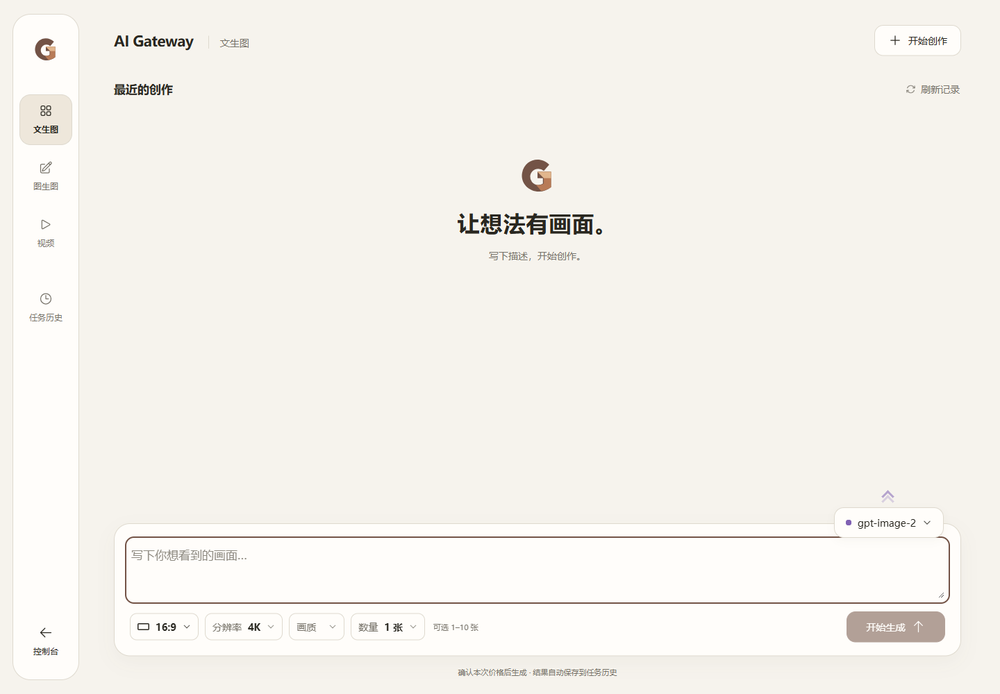

# ac8923ab 生产部署结果

**DEPLOYED_IMAGE_STATE_PRESERVED_VIDEO_DISABLED**。已上线并恢复访问；图片保持开启，视频关闭。本次没有真实供应商生成、付费测试、商品发布或价格修改。

## 固定身份与运行证据

运行源码 `ac8923ab666a77acc3675024c286ff2effff9546`；验收脚本 `6a3c6e3a0116829abe0364adb973ac7ccc529fce`。复用已验收TAR，未重建。最终manifest SHA256 `e02049a204c85e801db1a643640caeb98747e9ede90dce50c61ab8ea8e38f232`。

| 组件 | config digest / Image ID | 运行 OCI manifest digest |
|---|---|---|
| core | `sha256:24c6fdf42705d35c9736c526b052efd5a9a6af964e8c3868725d86cfae2b7690` | `sha256:e78166bf05b68299c9bd839ab5431ff051d02def730165d9f492ddca1097b7e2` |
| bridge | `sha256:b3c86c854a915e977496ab78db7ed8bae8380c371aa24c8f2e63803abc07fad4` | `sha256:65142a7635c34b2c6675117ed0870e93acbd977363a2fcfac021a3598273b242` |
| bff | `sha256:85380819444bab8bafac475cb867f6a05ada90ec09c5dca189b8365cde294a6d` | `sha256:fbe06459ecd03646a3bea837ff10ebcdf540c5ff4a5aafb803b29d680b696836` |

OCI与config的关系已由本地/远端包及运行镜像核对；三组件运行文件SHA与候选一致，详见 [运行文件](production/runtime-files.json) 和 [部署汇总](production/deployment-summary.json)。

## 时间、配置及健康

- 首次现场核对：2026-10-15T02:09:08.152753+00:00。服务切换：2026-10-15T02:32:31.931924+00:00 → 2026-10-15T02:33:09.128792+00:00（37.197秒）。
- 登录验收完成：2026-10-15T02:34:33.463068+00:00；最后证据核对：2026-10-15T02:37:19.401753+00:00。首次核对到最后证据约28.19分钟，包含准备就绪至补充授权后恢复执行的17.11分钟间隔；不将等待算成容器切换耗时。
- Base：`/home/ubuntu/services/ai-gateway/phase5-launch-20261010-final-3bb336b/compose.json`。
- 生效overlay：`/home/ubuntu/services/ai-gateway/deploy-funds-ops-ac8923-20261015/compose.override.ac8923ab.json`；SHA256 `df5f5dd8ec85ec62463eb026fa0b8bc66e1c74570d945e44d8c5136974432cde`。仅替换三组件镜像；环境、managed-v1、legacy false、挂载不变。
- Core→Bridge→BFF定向重建；sidecar均附着新Core。三组件healthy，PostgreSQL/Redis容器身份未变且healthy；Caddy active，配置未变，没有全栈down。

## 非付费生产核验

- [管理员媒体工作台](https://laifufu.top/admin/media)、[客户作品桌](https://laifufu.top/video-studio)正常登录访问。1440/390文生图、图生图可进入，视频仍显示未开放；浏览器无页面错误。
- 1870合法组合完整覆盖，文生图/编辑报价、权限、发布规格及私有存储检查全部PASS。浏览器1361ms，服务端1069ms。
- 服务端分阶段毫秒：`{"eligibility_and_storage": 7, "final_dependencies": 26, "initial_dependencies": 28, "native_quotes": 632, "published_validation": 118, "spec_compilation": 255, "total": 1069}`。
- 4K / 16:9 / 3张：文生图、1张参考图编辑均HTTP 200，单位0.025 CNY、冻结总价0.075 CNY。只报价，没有素材准备或生成。
- 图片恢复执行一次管理员PUT，完成于2026-10-15T10:33:40.478+0800；正式开启内再次全量预检PASS。图片requested/effective均true，视频均false，视频持久记录不变。用户本次明确补充授权后才执行。
- 公网HTTPS/MIME正常，35份JS/CSS与Core直连字节一致，含MediaWorkbench、VideoStudio及OpsDashboard。未用Vite/fixture替代。
- 新版运维页面实际显示：本窗口 SLA 样本 0 笔：成功 0，失败 0。 小样本百分比不代表大范围故障；无样本不代表已恢复。 不更改告警阈值，也不将零样本解释为旧故障已恢复。
- 未调用真实任务恢复GET。管理员#1不是原任务用户#2，不冒充用户读取；刷新/下载/恢复不重复生成与结算复用同一ac8923候选104笔隔离证据。本次不在生产补造任务或执行可能触发首次结算的恢复接口。

## 业务保护与回退

- Account #77仍保存1份商品。所有账号商品/凭据mapping指纹、#77商品/规格/价格/销售标记、用户余额指纹、usage最新ID与视频订单更新时间切换前后完全一致。原unknown回执摘要未变；保护字段与前后值见部署汇总。
- 293条迁移ledger SHA256前后相同，无待迁移、checksum差异或迁移执行。未覆盖数据库、Redis、journal或原片。
- 唯一授权业务控制写入是重启后恢复原图片开启状态；不开视频，不调整商品销售标记。非付费预检/报价使用既有本地记录及存储检查。
- 回退资产：`/home/ubuntu/services/ai-gateway/deploy-funds-ops-ac8923-20261015/before`；部署前d893整组三镜像和配置均保留可用。**未发生回退**。
- 原生迟到首次结算和允许负余额合同原样保留，不宣称本次修复了它们。

## 发布守卫与截图

- ART-01：manifest/TAR/OCI/config/runtime文件均PASS。PUB-01/02：HTTPS路径、状态、MIME通过；PUB-03/04：正常URL资源与Core准确字节一致；PUB-05：精确运行身份、健康、页面及非付费功能通过；PUB-06：锁内基线/归属检查、完整回退资产通过，未实际触发回退。
- 截图来自生产真实页面，人工查看。未公开含账户页眉的运维全页截图，仅发布统计区域截图。

[手机图生图](production/production-edit-390.png) · [手机开关状态](production/production-paid-panel-390.png) · [视频仍关闭](production/production-video-1440.png) · [运维零样本展示](production/production-ops-panel-1440.png)

完整报告及脱敏证据已归档；Constraints SHA256 `88f1088b2f7c99d3461b93749211ca02ec624adb74c14b9ff6628cf32a5bafea` 未变。本次部署到此结束，不自动进行新的生成、测试或设置修改。
