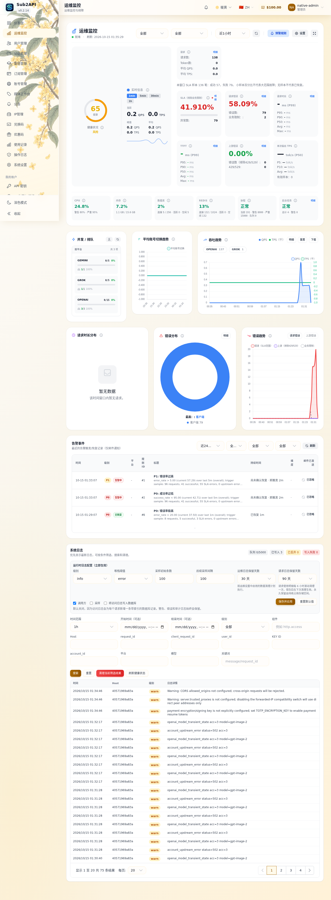
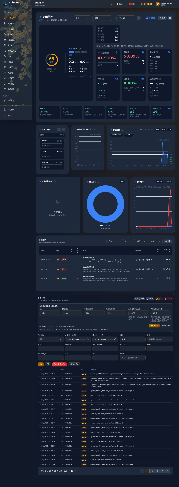

# 104笔资金核验与原生运维监控修复

**CANDIDATE_READY_NOT_DEPLOYED**。104笔资金核验、三组件隔离验收、CI和Security均PASS；未部署。原生迟到首次结算/负余额边界仍存在，详见下文，不宣称已消除。

生产保持用户已确认的 d893690a、图片开启/视频关闭；本轮没有生产连接、生产写入、真实供应商请求或开关调整。此文件是 Codex 执行交接，不替代根目录 ChatGPT 维护的正式 Handoff/Constraints。

## 结果与范围

104笔真实隔离 Core/Bridge/BFF/PostgreSQL 请求，模拟器仅替代上游。逐笔余额、冻结余额、原生usage/dedup、成品摘要及请求次数见 [资金逐笔CSV](evidence/native-funds-batch.csv) 和 [完整JSON](evidence/native-funds-batch.json)。金额是隔离合成数据。

| 场景 | 笔数 | 状态 | 本站实际结算CNY |
|---|---:|---|---:|
| 正常成功 | 24 | completed | 26.40 |
| 部分交付：3张中交付1张 | 12 | partial | 13.20 |
| 明确422失败 | 12 | failed | 0 |
| 502无最终结果 | 16 | unknown | 0 |
| 供应商断线 | 12 | unknown | 0 |
| 真实响应头超时 | 12 | unknown | 0 |
| 客户端取消后原结果迟到 | 8 | completed | 8.80 |
| 同身份重复请求 | 8 | completed | 8.80 |

合计52条原生usage、52条原生去重记录，57.20 CNY；4个用户各100.00→85.70。无预扣，释放0，冻结余额始终0。116次模拟上游POST包含partial的正常拆批，重复提交/查询/下载/真实Core重启及sidecar重新附着后没有额外生成或结算。104笔跨用户读取均拒绝。原生数据库另测16个并发重复结算，仍只扣一次。

**不能承诺不存在迟到首次扣费或负余额。** 现有原生合同在交付后结算；原调用仍在执行或原结果已持久化的任务，可迟到首次扣款。隔离PostgreSQL明确证明：余额0.25、有效首次结算0.80后为-0.55；重复同一结算不再扣款。此边界原样保留；若用户要求禁止透支或取消后不再首次结算，需要单独确定资金政策，不能偷偷改账本。

已经结束为unknown、没有结果且供应商无单笔查询API的任务，当前恢复只保留原身份，不重新生成、不猜退款、不凭余额推断结果；可长期未知，但没有长期资金占用。未将这类任务伪判失败。细节、代码位置、证据边界见 [FINDINGS.md](FINDINGS.md)。

## 实际修复

- 原生告警状态机：无数据/重启清零持续计数后，第一条仍超阈值的样本不能把旧告警错误恢复。仅有效且不超阈值的样本可恢复。
- 无请求样本显示“无请求样本”，不显示健康的0%错误率。
- 展示同一SLA窗口总数/成功/失败，触发事件在既有dimensions中保存同窗分母与时间。
- 旧firing文案改为“尚未确认恢复 · 距触发”，不把没有新流量说成持续大故障。
- 原有P0/P1阈值、持续条件和原生服务保持。测试覆盖1条样本、0样本、查询错误、10000条持续失败、有效正常恢复。

资金、图片/视频执行、商品、模型映射、报价、结算业务代码及数据库schema没有修改。资金证据发现的上述原生负余额边界没有被隐藏或改写。没有新任务平台、钱包、告警服务或供应商监测系统。

## 源码、CI与候选

- 分支：`codex/media-paid-controls`
- 运行源码：`ac8923ab666a77acc3675024c286ff2effff9546`
- 构建脚本：`6029967dbb430a2a250844b4725980d8a5876521`
- 最终验收脚本：`6a3c6e3a0116829abe0364adb973ac7ccc529fce`
- [构建Run 38662637715](https://github.com/maximeblen654-boop/AI-Gateway-public/actions/runs/38662637715)：三组件已导出，首次整体验收未通过；必须配最终补验manifest使用。
- 完整镜像Artifact：`11940351793`，到期 `2026-10-29T01:11:16Z`（北京时间09:11:16）。本地已归档，不依赖临时artifact永久保存。
- [最终补验Run 38665574538](https://github.com/maximeblen654-boop/AI-Gateway-public/actions/runs/38665574538)：PASS；加载同一候选，不build、不重新导出TAR。最终小证据Artifact `11940744484`，到期 `2026-10-29T01:35:32Z`（北京时间09:35:32）。
- [运行源码CI 38661742587](https://github.com/maximeblen654-boop/AI-Gateway-public/actions/runs/38661742587)、[Security 38661742565](https://github.com/maximeblen654-boop/AI-Gateway-public/actions/runs/38661742565)：PASS。
- [最终脚本CI 38665574027](https://github.com/maximeblen654-boop/AI-Gateway-public/actions/runs/38665574027)、[Security 38665574030](https://github.com/maximeblen654-boop/AI-Gateway-public/actions/runs/38665574030)：均PASS，见[原始Run状态](evidence/run-provenance.json)。
- 包含负余额及并发去重的真实PostgreSQL测试：CI `38662107443` PASS；integration模式在CI缺Docker会失败，不会静默跳过。

三组件使用既有linux/amd64配方，本轮Bridge/BFF业务无改动；镜像均真实构建自ac8923，未伪标旧包来源。以下为config digest/Image ID，OCI manifest摘要另见 [离线TAR身份核对](evidence/local-integrity.json)。

### core

- source SHA：`ac8923ab666a77acc3675024c286ff2effff9546`
- Image ID/config digest：`sha256:24c6fdf42705d35c9736c526b052efd5a9a6af964e8c3868725d86cfae2b7690`
- TAR：`core-ac8923ab666a77acc3675024c286ff2effff9546.tar.gz`
- TAR SHA256：`19adcc3908ab51e7796d56dd481a27575d3b7657479d293bb5648cf5ca82e13e`

### bridge

- source SHA：`ac8923ab666a77acc3675024c286ff2effff9546`
- Image ID/config digest：`sha256:b3c86c854a915e977496ab78db7ed8bae8380c371aa24c8f2e63803abc07fad4`
- TAR：`bridge-ac8923ab666a77acc3675024c286ff2effff9546.tar.gz`
- TAR SHA256：`8ca90d6c31a2f9895fe410b6fae7b5a4d0cb3d58277a9966773cbc6a2b92f800`

### bff

- source SHA：`ac8923ab666a77acc3675024c286ff2effff9546`
- Image ID/config digest：`sha256:85380819444bab8bafac475cb867f6a05ada90ec09c5dca189b8365cde294a6d`
- TAR：`bff-ac8923ab666a77acc3675024c286ff2effff9546.tar.gz`
- TAR SHA256：`9a3802a7790dfb93b4c7210be3474fdc7850ae147bff2d72a93642d2622735bc`

## 截图和复核

以下为最终Core镜像提供的真实Vue运维页面，隔离数据库与模拟上游。不是生产截图、Vite或API mock。浅/深色1440px和390px均进行无横向溢出检查和人工查看；窗口内统计含整个验收的合成流量，不以其百分比代表生产。

| 桌面浅色 | 桌面深色 |
|---|---|
|  |  |

[手机浅色原图](evidence/native-ops-390-light.png) · [手机深色原图](evidence/native-ops-390-dark.png)

原生统计将比率四舍五入到4位小数；验收同时核对error_rate与SLA、实际分子分母，不用未取整值误判失败。浏览器资源与Core直连资源逐字节SHA核对见native-ops.json。

## 构建与验收失败的处理记录

- d893基线Run38661764960：104笔资金断言通过，随后重启测试受到Node旧连接关闭事件影响。仅调整脚本Connection:close和等待真实健康，不改运行代码。
- 本次构建Run38662637715：导出三镜像成功，整体验收仍受上述脚本问题影响，原manifest为NOT_PASSED，保留原件。
- 补验Run38663261345：104笔及真实重启/恢复全部PASS，最后监控脚本将原生4位小数比率与未取整值比较而失败。只改脚本，不改镜像。
- 最终补验使用同一组TAR/config digest，最终manifest与原manifest的images必须完全相等。

## 下一轮部署条件与回退

本轮只交付候选；下一轮必须单独授权。部署前核对当时生产实际整组三组件、managed-v1实际状态、网络附着、挂载和回退资产，不能假定仍为旧快照，也不能复制隔离Compose。无schema变化；无需迁移数据库、覆盖Redis、journal或原片。

限定回退是恢复部署前整组三组件和配置，Core健康后重新附着Bridge/BFF；部署前确认兼容和实际开关恢复授权，不自动改变图片/视频状态。保留现有d893等回退资产。本轮没有验证生产回退操作，不把方案称为执行成功。

发布守卫：ART-01隔离产物身份、PUB-05隔离功能由manifest、runtime-files、acceptance及浏览器资源/资金证据覆盖；PUB-01/02/03/04和生产阶段PUB-05/06本轮N/A，须下一轮现场验收。没有以云端PASS代替上线证据。

唯一完整本地包：`D:/AI-Gateway-candidate-ac8923ab6-final/`。保留`manifest-build-not-passed.json`，最终PASS清单和小证据已归档。同一份TAR仅下载一次，未在本地构建；C约5.29GiB、D约6.74GiB，未清理共享缓存、正式候选、生产或回退资产。

## 最终产物与部署准备结论

- [最终manifest](evidence/manifest.json)，SHA256：`e02049a204c85e801db1a643640caeb98747e9ede90dce50c61ab8ea8e38f232`。
- 本地同一清单：`D:/AI-Gateway-candidate-ac8923ab6-final/manifest.json`。三个TAR的摘要与原构建一致；OCI manifest与config digest已离线交叉核对，不混用两种摘要。
- [最终三组件健康/网络/挂载](evidence/acceptance.json)、[运行文件摘要](evidence/runtime-files.json)、[104笔复核汇总](evidence/funds-audit-summary.json)。
- [监控浏览器证据](evidence/native-ops.json)：最终Core提供的47份JS/CSS与直连Core逐字节一致，含OpsDashboard及MediaWorkbench；1440/390浅深色检查通过并人工查看。
- [文生图](evidence/native-customer-image-geometry-1k.json)、[参考图编辑](evidence/native-customer-edit-geometry-2k.json)、[单视频](evidence/native-customer-video-compatible.json)、[任务恢复与继续创作](evidence/native-task-experience.json)均PASS。
- [付费控制](evidence/native-paid-controls-verify.json)：冻结依赖变化、权限拒绝、余额不足、BFF故障均不绕过；图片/视频独立。 [1870组合](evidence/native-paid-controls-scale.json)三次浏览器检查550/353/367ms，正式开启二次检查也通过，全部仅隔离模拟；结束两项关闭。
- [证据文件摘要](evidence/SHA256SUMS.txt)可校验归档，云端临时artifact不作为永久备份。

本候选技术验收通过，可以进入单独的部署审批；没有授予自动部署权限，也不能据此声称原生迟到首次扣款/负余额政策已经改变。若下一轮要求禁止该行为，需先明确资金政策并另行验证相应修改；不以监控更新暗中改变原生结算。
