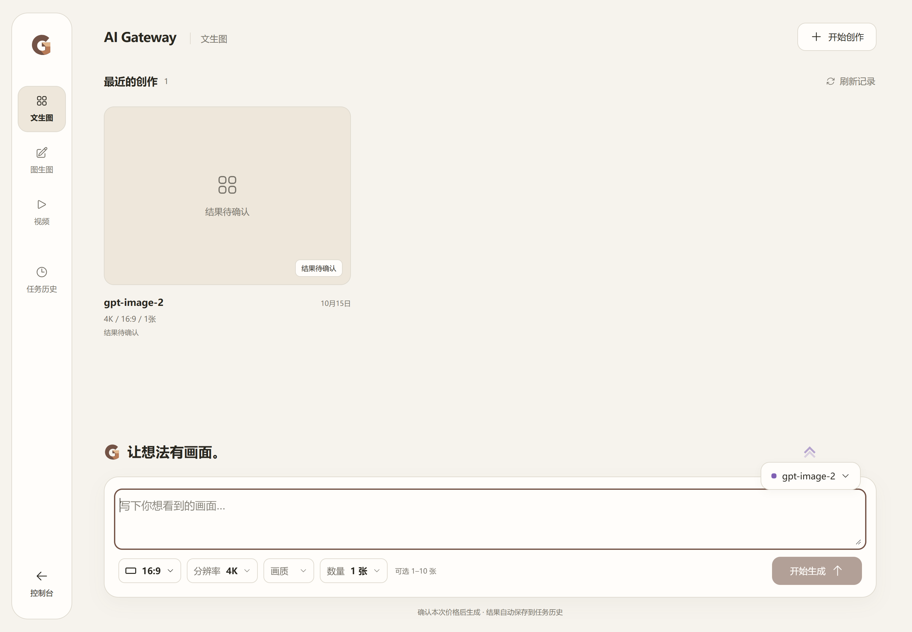
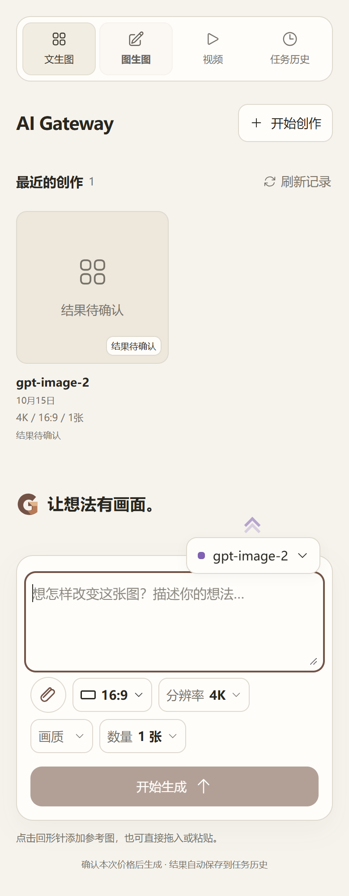
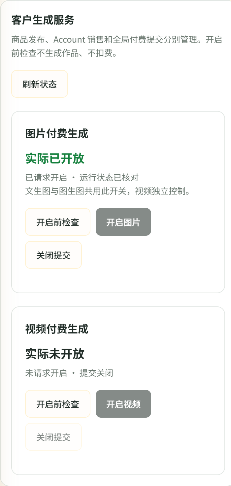

# 4f10be20 图片 HTTP 502 终态修复生产部署

**DEPLOYED_IMAGE_STATE_PRESERVED_VIDEO_DISABLED**。固定三组件已上线、正常访问已恢复；图片 requested/effective=true，视频 requested/effective=false。没有供应商生成、自动重试或付费测试。本次部署不证明 Image2Pro 的上游502已解决。

## 固定身份和时间

- 三组件运行源码：`4f10be20ef06bc0a7670822e88eefd60c53d09c9`。验收脚本`98a8e190bdbaefdfaa6381ee0665e6456b35bbdb`；文档归档提交不是镜像源码。
- 完整Artifact **11959853877**；最终补验Run **38711354552 PASS**，CI **38710997846 PASS**，Security **38710997965 PASS**。未重新构建。原构建NOT_PASSED清单单独保留，最终PASS清单与其三份TAR/config/OCI身份一致。
- [Manifest](deployment-evidence/manifest.json) SHA-256：`a5fc9bcbd846d0e11cf7b958ae2393e1c96caf74e5b91e9e807f0cddc38dc657`。
- 生产切换北京时间 **21:01:11.118 → 21:01:48.651**，**37.533秒**；受保护验收完成 **21:03:30.992**。从本次首个执行时间记录到报告约 **16.8分钟**，包含产物传输、校验和证据整理，不含此前规则阅读。没有等待用户登录，复用了现有会话。
- 基础Compose保持 `/home/ubuntu/services/ai-gateway/phase5-launch-20261010-final-3bb336b/compose.json`。
- 生效overlay：`/home/ubuntu/services/ai-gateway/deploy-image-502-4f10be20-20261015/compose.override.4f10be20.json`，SHA-256 `0b586ccc2d1dbd27aa7fb8bf7296f20436d29356de59789d10b9da730d046ec2`。仅变更三镜像，环境/认证/managed-v1/挂载保持；legacy付费环境开关仍false。

| 组件 | config digest / Image ID | 生产运行 OCI manifest |
|---|---|---|
| core | `sha256:34242d4051dd842e48ef5ba60af853da810410cf5c6cffe0dda1d054c5d4c918` | `sha256:fb7b46046f8abf255ad7013c4296de24cc956b6b18e44313b7d9af38aeeae1c0` |
| bridge | `sha256:c687e5dd1d5d6832b20a2a544a7bf0d55900c6fe45659fe5e619755b1349e493` | `sha256:3d3c0a4c07ca4fc92fe5af0865d50b47f2c9783a3acb70bdc209cb5b423aded6` |
| bff | `sha256:5f557e082f1bf8004396b1ac10f345cce4b75cf97cf098990b7d2dd5cae2d744` | `sha256:c0496b56b01c7f87886e53e5d010380e3f7b73b93355f1042bbf9877da02c686` |

OCI与config是不同对象，已核对关联；三组件实际运行文件大小和SHA与最终隔离候选一致。完整[结构化证据](deployment-evidence/deployment.json)包含TAR摘要、实际容器身份、网络、保护指纹和阶段耗时。

## 生产验收

- Core、Bridge、BFF healthy，sidecar附着新Core namespace。PostgreSQL、Redis容器ID未变且healthy；Caddy active、配置哈希未变。
- [管理员工作台](https://laifufu.top/admin/media)和[客户作品桌](https://laifufu.top/video-studio)登录后验收通过。真实生产Core提供页面；1440px桌面/390px手机文生图、编辑、视频均可进入，图片可用、视频未开放。17份实际JS/CSS公网与源站字节一致，无浏览器页面错误。截图已人工检查。
- 图片开启前完整 **1,870组合PASS**：浏览器 **1,444ms**，服务端 **1,124ms**。服务端阶段：依赖36ms、准入/存储9ms、发布校验127ms、规格编译266ms、原生报价660ms、最终依赖23ms。
- 恢复图片时再次执行 **1,870组合PASS**，服务端 **998ms**。图片requested/effective=true；视频两项false，视频控制记录未变。
- 文生图/参考图编辑非付费报价均HTTP200：4K/16:9/3张，单价0.025 CNY、总价0.075 CNY。没有准备真实素材、提交生成或重发任务。
- 现有原生Key工作台入口HTTP200，现有用户Key数量未变；未为本次验收创建无Key生产测试用户。

## 业务保护与回退

- Account77原1份商品以及全部Account商品/mapping/凭据指纹一致；未保存、发布、改价或修改Group31。
- 两位用户余额及frozen_balance指纹一致。usage_logs **24→24**、usage_billing_dedup **24→24**、archive **0→0**，各自全表行摘要一致；视频订单 **2→2**及行摘要一致。
- 三笔历史unknown任务回执SHA全部不变。浏览器拦截了页面自动尝试的旧任务恢复GET，没有为验收调用可能结算的恢复接口。
- 没有数据库迁移、任务清理、补扣、退款或回退。新502无交付的failed/not_charged及迟到保护复用固定候选隔离证据，未用生产付费请求制造新终态。最终扫描新终态文件0、在途执行单元0。
- 部署前2bd整组镜像仍可用，配置恢复资产：`/home/ubuntu/services/ai-gateway/deploy-image-502-4f10be20-20261015/before`。
- **回退有条件**：旧2bd不认识新增unit outcome，恢复时会返回ErrStudioImageConflict，不能无条件降级。切换脚本在恢复前检查无新502终态、无在途执行、业务/迁移及配置归属一致；一旦出现新终态，停止自动降级并保留数据，不覆盖数据库、回执、journal或原片。正式恢复图片发生在全部验收通过后。

## 截图

这些是生产真实页面，不是隔离fixture。历史unknown仍显示待确认，符合未授权修改旧任务的边界。

## 归档与停止

完整且校验通过的三TAR、最终manifest保存在服务器本次发布目录 `/home/ubuntu/services/ai-gateway/deploy-image-502-4f10be20-20261015/`；GitHub完整Artifact到期 **2026-10-29 09:06:02 UTC**。本地 `D:/AI-Gateway-candidate-4f10be20e-final/` 仅保留manifest和归档位置说明，**不是完整镜像包**；本地回传过慢，已停止并删除不完整文件，未继续挤占C/D盘。小报告/截图在 `D:/AI-Gateway/output/deploy-image-502-4f10be20-20261015/`。

[发布守卫清单](deployment-evidence/release-checklist.json)。Constraints SHA-256保持`88f1088b2f7c99d3461b93749211ca02ec624adb74c14b9ff6628cf32a5bafea`。本轮结束，不自动修正三笔历史任务，不开放视频，不执行真实付费生成。
