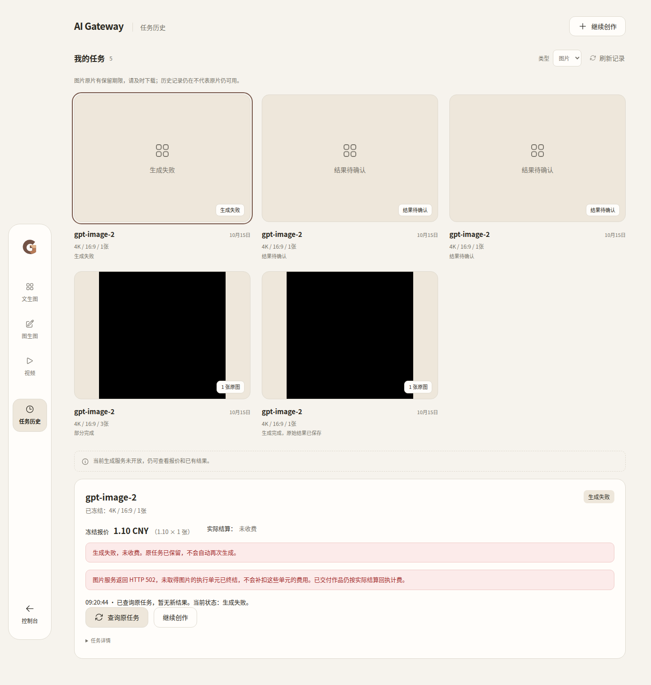
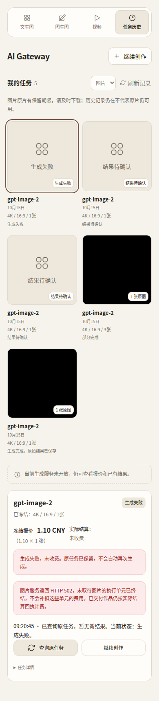

> 2026-10-15 22:24后续事实：用户已单独授权并完成三笔历史502零收费终态修正，3笔failed/not_charged，0跳过，原件/claim/资金保护通过；生产仍4f10，图片true/视频false。见[一次性执行报告](HISTORICAL-FINALIZATION.md)。下方“三笔历史未改”仅描述部署时点，当前以本段为准。

## 2026-10-15 生产部署更新

固定4f10be20已完成授权生产部署：**DEPLOYED_IMAGE_STATE_PRESERVED_VIDEO_DISABLED**。图片requested/effective=true，视频false。1870生产预检及开启二次检查通过，三笔历史unknown未改。详见[实际部署报告](DEPLOYMENT.md)。旧2bd对新增终态的降级限制与归档位置见该报告；不将供应商502标为已解决。以下候选证据保留追溯。

# Image2Pro HTTP 502 customer finality

Status: CANDIDATE_READY_NOT_DEPLOYED.
Production remains 2bdbe3e8; no production calls or writes in this task.

## Customer contract
The native synchronous OpenAI-compatible Image2Pro API-key path records actual HTTP error evidence before native error translation. Existing exact Image2Pro base recognition is reused (no model-name or Account-ID allowlist). Only an explicit 502 without possible image output gets the new no-charge final unit outcome. Other suppliers, OAuth/Responses, transport failures, timeouts and historical unknown outcomes retain their existing contract. A 502 is NOT evidence of supplier refund.

Existing permanent dispatch claims prevent replay. Private unit outcome/receipt retains status, request ID, sanitized bounded message and error response digest. Final units refuse replacement; final task recovery returns without settlement; result persistence and native billing reject not_charged. Mixed units use existing delivered-quantity settlement once. Customer API receives a fixed failure code, never supplier diagnostics or credentials.

## Historical tasks: proposal only
No historical mutation on deployment, refresh or query. The following receipts and their pre-deployment SHA-256 were verified by the prior read-only investigation and deployment; this task reuses that evidence, not a new production query:

| Task | Request | receipt SHA-256 |
|---|---|---|
| img_246553331bf3e4639ab4adbe94fcccc2 | bdfccad4-adb0-4c1c-a67d-f89c19fc9935 | 6ec8c567030fcc504978a734114a26504e55fe44b3840a62d6ef652e892e6d46 |
| img_66c5f21b1cc78570f98ae244b7ce67a1 | 55bb1465-791b-4783-ab6c-822e3f19a710 | bcfd21f11cc1794710c89c78194df24ba9524fe481ec7bbb316546a3ff110cce |
| img_f372e5916f913ebc4358129c65add930 | c49b9bed-0527-498e-ad5b-8819a2db4073 | c6928ef9f87521a15c5647d3a0df4d353a1f23e41b5b642c041a5075fc524206 |

Prior evidence: each has one native HTTP 502 attempt, no original image or delivery, and no native task settlement. Supplier records strongly correlate but have no shared supplier request identifier; no refund assertion is made from HTTP status. Historical raw response bodies were not preserved. See ../2026-10-15-upstream-errors-studio-entry/DEPLOYMENT.md and its read-only investigation evidence.

Separate authorization is needed to finalize these specific historical customer tasks. Before any such remediation, recheck exact receipt/claim/owner/quote hashes, native HTTP status evidence, zero outputs and zero native usage/dedup/settlement, and exclude an active dispatcher/recovery. Preserve originals and claims. Under a bounded exclusive maintenance operation, write an auditable policy-finality outcome tied to the existing request identity; never invent a lost response-body digest or supplier refund. Set only the customer no-charge finality and refresh the derived BFF view. No POST, balance adjustment, deletion or replacement order. If new delivery or settlement evidence exists, skip that task and report. No remediation tool or production action is included here.

## 最终验收与身份

- 运行源码（三组件）：`4f10be20ef06bc0a7670822e88eefd60c53d09c9`。
- 最终测试/验收脚本：`98a8e190bdbaefdfaa6381ee0665e6456b35bbdb`。后续只修改测试类型断言、开关响应外层读取、既有镜像补验范围与编辑覆盖；运行源码未变。
- [构建 Run 38709394404](https://github.com/maximeblen654-boop/AI-Gateway-public/actions/runs/38709394404)。完整镜像 Artifact `11959853877`，名称 `native-media-candidate-4f10be20ef06bc0a7670822e88eefd60c53d09c9`，211,830,282 bytes，到期 **2026-10-29 09:06:02 UTC**。首次脚本错读 action.state，manifest 是 NOT_PASSED；镜像不重建，以最终补验 manifest 为准。
- [最终补验 Run 38711354552 PASS](https://github.com/maximeblen654-boop/AI-Gateway-public/actions/runs/38711354552)，小证据 Artifact `11961067411`，到期 **2026-10-29 09:20:48 UTC**。同组 TAR/config/OCI 摘要在 runner 重新核对、加载，无重导出。
- [CI 38710997846 PASS](https://github.com/maximeblen654-boop/AI-Gateway-public/actions/runs/38710997846)，[Security 38710997965 PASS](https://github.com/maximeblen654-boop/AI-Gateway-public/actions/runs/38710997965)。前一次 lint 的三个测试类型断言已修正；不隐藏失败记录。
- [最终 manifest](evidence/manifest.json)，SHA-256：`a5fc9bcbd846d0e11cf7b958ae2393e1c96caf74e5b91e9e807f0cddc38dc657`。

| 组件 | Image ID / config digest | TAR SHA-256 |
|---|---|---|
| core | `sha256:34242d4051dd842e48ef5ba60af853da810410cf5c6cffe0dda1d054c5d4c918` | `5467aeeef2c0366d9f45bf9696bf766bfaef0857afc2adc0895e633caa2231de` |
| bridge | `sha256:c687e5dd1d5d6832b20a2a544a7bf0d55900c6fe45659fe5e619755b1349e493` | `963c509228fc5cdc24b0f3224359b7c5082a27b5dda798082aac59b16025dacd` |
| bff | `sha256:5f557e082f1bf8004396b1ac10f345cce4b75cf97cf098990b7d2dd5cae2d744` | `969613118d491aad88aa35d11522bc8010aed2436916ca4a51ac34e9b619ab02` |

完整 OCI manifest → config 关系、TAR 文件名、字节数见最终 manifest。只准备候选，未连接生产、未切换服务或开关。

## 行为和资金证据

[逐笔 JSON](evidence/native-image-finality.json) / [CSV](evidence/native-image-finality.csv)：真实隔离 Core、Bridge、BFF、PostgreSQL、Redis，只有上游是本地模拟器。合成 Image2Pro 域名由容器 hosts 固定到 127.0.0.1，TLS 443 由本地模拟器接收；没有真实上游调用。页面来自最终 Core，不是 Vite 或 API mock。

共 20 笔：文生图 10、私有参考图编辑 10；每类场景包含两种入口。

| 场景 | 笔数 | 客户终态 | 本站实际结算 |
|---|---:|---|---|
| 正常成功 | 4 | completed | 每笔交付1张，1.10 CNY，一次usage+dedup |
| 首单元成功、第二单元502 | 4 | partial | 请求3张，交付1张，每笔1.10 CNY；失败及未发单元不收费 |
| 明确502无交付 | 4 | failed / not_charged | 0；无usage/dedup，无占用，不迟到补扣 |
| 断线无明确响应 | 4 | unknown / pending | 当前0，无占用；保持原有未知结果合同 |
| 真实响应头超时 | 4 | unknown / pending | 当前0，无占用；保持原有未知结果合同 |

4个独立合成客户均从100到97.80，总计8.80 CNY；过程采样及最终 frozen_balance 均0。24次模拟原始生成POST（4成功+8部分成功/502+4全502+4断线+4超时），显式重复提交、查询、下载、真实Core重启后查询没有新增生成或结算。跨用户读取拒绝；原片摘要一致。以上均为模拟资金，不代表供应商实际退款。

单元测试另外覆盖：晚到写入拒绝、not_charged 结果保存及结算拒绝、历史无新证据502仍unknown、其他供应商/503/伪造网关502不误套用、错误脱敏、矛盾502携带可能图片输出不强行终结。仅明确无交付502使用新终态；未知任务仍可能在可靠恢复交付后首次结算，原有合同没有全局改变。

相关旧流程的受影响回归：文生图3张、编辑2张、兼容视频1条、原片下载/播放、任务等待与继续创作、零Key网页入口、权限及开关失败关闭均PASS，见[回归摘要](evidence/regression-summary.json)。未重复104笔及1870组合全量验收。

## 客户界面

已人工查看最终候选的桌面/手机截图：失败和“未收费”清楚显示，保留HTTP502的安全说明、查询时间和继续创作；无控件重叠或水平裁切。截图上的未开放提示来自隔离重启后 managed-v1 正常失效，不是生产开关变化。黑色缩略图是模拟1像素图片，不是真实供应商作品。

## 范围、历史修正与部署条件

修改集中在原生 HTTP 响应证据、现有 receipt/unit outcome、恢复/结算保护以及 BFF/Vue 的固定失败码与文案；没有新钱包、任务平台、供应商查询服务、重试器、数据库 schema 或 migration，依赖锁不变。

三笔历史任务仅复核已有归档证据并提出上方方案，未重新查询生产恢复接口、未改终态或余额。历史修正与新候选上线均需单独授权，不能把部署理解为批量修正旧单。

生产最后已核实基线是2bdbe3e8，图片开启、视频关闭；这是上轮部署证据，本轮没有重新在线核实。下一次部署须现场复核三组件、配置、业务指纹、回退资产和 managed-v1 重启后状态；不得仅凭本候选将图片/视频开启。回退只限定组件和本次配置，不覆盖数据库、journal或原片。若上线后已有新终态，降级前须核对旧代码读取/结算语义，不能承诺无条件回退。

发布守卫适用性：ART-01 **PASS**（真实TAR/OCI/config、容器二进制大小与摘要、实际Core前端字节及隔离功能）；PUB-05 隔离范围 **PASS**（三组件healthy、共享网络与浏览器/业务）；PUB-01/02/03/04与PUB-06生产采样/回退资产 **N/A于本次非生产任务**，下一次部署前仍必须实测，不能沿用为本次线上PASS。生产启售、真实生成和供应商退款均未测试。

## 资源处理

[定向清理记录](RESOURCE_USAGE.json)：删除项目 go-tmp 下12个无进程使用的失败编译目录，实际释放2,004,983,808 bytes（约1.87GiB）。归档后又删除本轮两份重复临时下载，释放21,463,040 bytes；最终D约10.16GiB、C约4.72GiB。有效共享缓存、正式候选、回退资产、源码和持久数据保留。最终本地仅保留小报告/截图，完整候选一份在GitHub；不是永久备份，到期时间见上方。没有本地Docker构建。

本地最终Go补编遇Windows内存不足，未继续挤占本地资源；最终完整Go/前端/安全依据为上述GitHub CI。Constraints保持原文，SHA-256 `88f1088b2f7c99d3461b93749211ca02ec624adb74c14b9ff6628cf32a5bafea`。

下一状态：**CANDIDATE_READY_NOT_DEPLOYED**。停止，等待新候选的单独部署授权。
