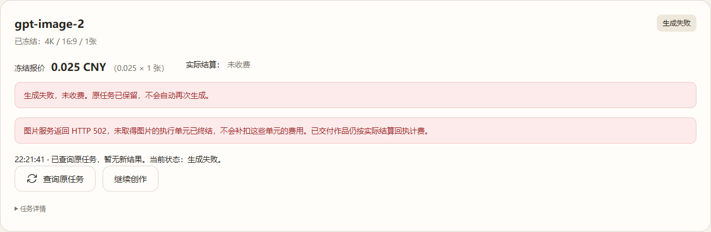
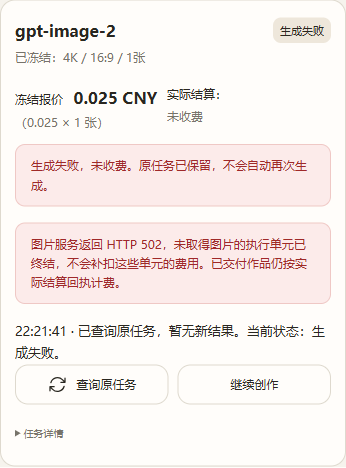

# 三笔历史 Image2Pro 502：授权一次性终态修正

**HISTORICAL_502_FINALIZATION_COMPLETED**。3笔全部处理，0笔跳过。原任务仍在，归属、规格、冻结报价、请求身份和原始dispatch claim保持；客户终态为“生成失败，未收费”。这是本站零收费终结，不宣称供应商已退款或内部502已解决。

## 逐笔结果

| Task | 原冻结报价 CNY | 最终状态 | 交付 | 本站实际结算 |
|---|---:|---|---:|---:|
| img_246553331bf3e4639ab4adbe94fcccc2 | 0.075 | failed / not_charged | 0 | 0 CNY |
| img_66c5f21b1cc78570f98ae244b7ce67a1 | 0.025 | failed / not_charged | 0 | 0 CNY |
| img_f372e5916f913ebc4358129c65add930 | 0.025 | failed / not_charged | 0 | 0 CNY |

任务1/2仍属User2/Key3；任务3属User1/Key4；Group31、Account77不变。三笔原生usage/dedup/archive均0；两位用户余额不变，frozen_balance及Redis inflight占用均0。没有补扣、退款或维护SQL写入。

## 执行与安全证据

- 生产仍为`4f10be20ef06bc0a7670822e88eefd60c53d09c9`。三容器ID、镜像、StartedAt均未变化，healthy；图片requested/effective=true，视频false。没有重新部署、重启或修改开关。
- 北京时间22:16:10.168开始，22:16:15.670完成；应用冻结写入窗口22:16:13.279～22:16:15.670，约2.391秒。PostgreSQL、Redis持续运行。
- 重新核验三receipt授权SHA、owner/Key/Group/Account、单元payload、报价、Core Request ID、BFF身份索引/指纹及三层永久claim；原生历史502归档与外层Ops行31/32/33对应。历史正文及供应商请求ID没有保存，未伪造。
- 21份原件逐一备份并fsync，部署互斥锁+应用进程冻结阻止写入竞争；写前二次SHA核验，依次原子写单元终态、主回执、BFF视图，共9个文件。原claim和索引不动。
- 单元终态禁止晚到结果替换；Core恢复直接返回not_charged，结果保存及原生结算拒绝。中断在单元写入后也可由原恢复机制完成零收费终结。没有重新发送原POST。
- 每笔实际原生GET读取两次均200/failed/not_charged，回执哈希不变。部署中BFF真实history读取确认3笔视图；当前User1正式浏览器确认任务3桌面与390px手机显示、查询完成反馈。未声称已经登录User2浏览器。
- 写入后只改变上述6个Core文件+3个BFF文件。其他journal、claim、身份索引、原片文件摘要一致；usage/dedup/archive、视频订单及Group全表摘要一致。Account77全字段保持；全Account表在冻结维护前后相同。
- 原生鉴权GET核验更新了Key3/4的last_used_at、updated_at（22:23:47/48），来自既有TouchLastUsed/UpdateLastUsed，不是资金扣款或Key权限变化。因此不宣称核验后api_keys全表字节不变。维护写入窗口前后该表一致。
- 预备阶段首次全Account指纹检查因其他Account的原生探查元数据变化被拒绝，尚未写任务。只读样本识别16/26的extra和updated_at变化；随后保留Account77逐字段检查，并在进程冻结期间比较整表，未关闭或修改任何探查配置。不把整个观察期的后台元数据说成完全不变。

## 隔离验证与源码

维护工具/最终检查提交：`6345982383229afdb682c671f851c7cdd396bd53`，仅一次性工具及测试，没有新应用运行代码或候选。

- Python正向、冲突拒绝、重复修正拒绝、POSIX原子CAS/权限/原件不可覆盖测试通过。
- 真实Go Store/Recover/Dispatch/Settle测试：历史unknown先复现；单元先提交后的恢复、旧恢复快照、重启读取、重复提交不POST、晚到写入/结果保存/结算拒绝、越权读取拒绝通过。
- 真实BFF运行函数：更新视图保留quote/request/owner/Key/claim，历史读取、重复查询及重复提交不POST通过。
- [最终CI PASS](https://github.com/maximeblen654-boop/AI-Gateway-public/actions/runs/38749576935)、[Security PASS](https://github.com/maximeblen654-boop/AI-Gateway-public/actions/runs/38749576985)。生产写入前，核心隔离回归已由[首轮CI PASS](https://github.com/maximeblen654-boop/AI-Gateway-public/actions/runs/38747886956)及相同原子/BFF测试验证。

## 回执摘要

**img_246553331bf3e4639ab4adbe94fcccc2**

- Before: `6ec8c567030fcc504978a734114a26504e55fe44b3840a62d6ef652e892e6d46`
- After: `499070da2d70e04cb5bd5f9e2dac73d378a8d439b5e8a55fa8977b5d0e6da1e9`

**img_66c5f21b1cc78570f98ae244b7ce67a1**

- Before: `bcfd21f11cc1794710c89c78194df24ba9524fe481ec7bbb316546a3ff110cce`
- After: `bb82740bfe70d156563a2c3ca0d04f82bc02b6664145fb3d4ad445e3507dfdab`

**img_f372e5916f913ebc4358129c65add930**

- Before: `c6928ef9f87521a15c5647d3a0df4d353a1f23e41b5b642c041a5075fc524206`
- After: `756ecf57fb9ddc62883023d9131605c7e70a190b9d065196c58bd97c0e6e5cda`

所有单元与BFF前后摘要、账务保护指纹、查询结果及镜像身份详见[机器可核验报告](historical-evidence/result.json)。历史[原生502脱敏证据](historical-evidence/native-evidence.json)。

## 客户页面

来自当前生产Core，非fixture。显示生成失败、未收费、不会自动再次生成；查询完成后可继续创作。

## 备份及收尾

服务器私有原件和审计：`/home/ubuntu/services/ai-gateway/maintenance-historical-502-20261015/`，`originals/`共21份，权限0600，原始用户输入和quote标识不上传GitHub。`intent.json`、每任务committed.json、`applied.json`保留。

**现在确实存在新终态，不能再套用“无新终态”的旧2bd回退条件。** 不将备份unknown恢复覆盖已终结记录。未来降级必须保持4f10终态与结算保护兼容；本轮无回退。

正式根Handoff按本次结果更新；Constraints原文不变。维护已结束，不继续生成、开放视频或进行其他业务操作。
