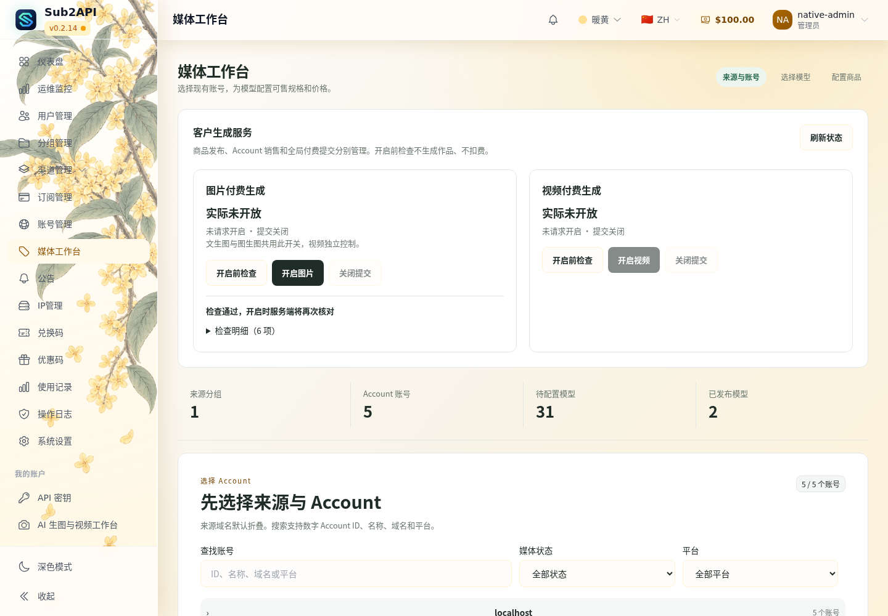
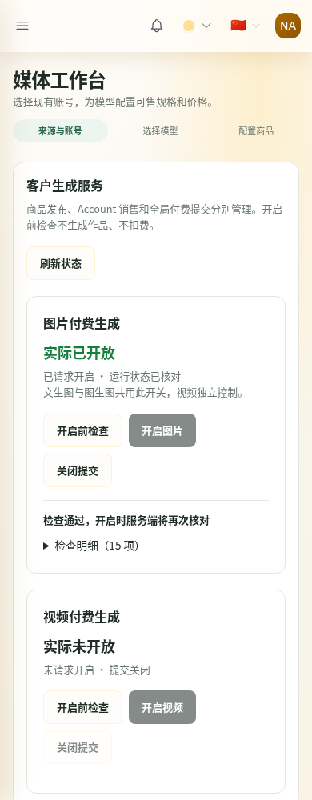

# 图片开启前检查超时修复：候选交接

**CANDIDATE_READY_NOT_DEPLOYED**。仅非生产开发、GitHub-hosted 隔离验收及离线归档；没有连接生产、部署、开启生产图片/视频或调用真实供应商。

## 固定身份

- 分支：`codex/media-paid-controls`。
- 运行源码及构建脚本：`1ab3838a0dc40a32973ae06cc440b210f0a9d842`。
- 最终验收脚本：`3b3698723510c0ccea76ea681698113bd7d983b8`，只有 fixture 修正，没有运行代码变化。
- 构建 Run：[38623006825](https://github.com/maximeblen654-boop/AI-Gateway-public/actions/runs/38623006825)，完整 Artifact `11922663136`。构建成功、初次新增 scale 断言失败，不能单独用该 Run 声称候选验收成功。
- 同镜像补验 Run：[38624490131](https://github.com/maximeblen654-boop/AI-Gateway-public/actions/runs/38624490131) **PASS**，证据 Artifact `11923002799`。下载并加载原 TAR，验证全部摘要/身份，没有再次 build/export。
- 完整 Artifact 内初次 manifest 为 NOT_PASSED；部署准备必须配合补验证据 Artifact 的最终 manifest。其三个 image/TAR 记录与原包逐项相同，原包没有被伪标成新构建。
- 最终 [manifest](evidence/manifest.json) SHA-256：`f1ad7be33ea23d1c3b5ebec2a562fb822eb854b50a3f1564ade70ae8bf0d9f35`。
- 本地唯一完整候选：`D:/AI-Gateway/output/preflight-timeout-20261015/candidate/`；最终补验证据：同级 `acceptance/native-candidate-output/`；首次失败 manifest/scale 记录：同级 `first-attempt/`。
- 完整 Artifact 到期：2026-10-28 19:30:01 UTC（北京时间10月29日03:30:01）。补验证据到期：2026-10-28 19:35:28 UTC。GitHub artifact 有效期14天；本地已归档一份 TAR，非永久云端备份。

## 根因和最小修复

原路径对每个规格调用 `ResolvePublishedImageOffer → publishedReady → Validate`。同一个请求内重复验证的是同一仓储快照，并非每个规格重新读取生产依赖。1,870 组合因此触发约1,870次全量商品校验。

`InspectPublishedOffers` 在一次同步调用内验证完整 Published 快照一次，然后对每个合法组合调用与原公开入口相同的私有单规格解析器、执行计划和参数编译器。没有跨请求缓存、抽样替代或公开跳过验证的解析入口。正常客户报价以及文生图/编辑各自的原生非付费报价仍保留自身校验。

权限、余额/订阅、成本、素材/结果存储、冻结售价、映射与发布依赖校验保留。结束检查和正式开启写入前继续重新读取指纹。未发布 Draft 不改变冻结 Published 合同。完整校验和逐规格循环支持取消/超时；取消后的开启动作不得授予有效权限。管理员响应仅新增安全汇总 metrics。

主要运行改动：`backend/internal/mediaworkbench/{preflight,validator,adapter,runtime,video_runtime}.go`、`backend/internal/service/{studio_paid_preflight,studio_paid_control}.go`。没有客户端超时、前端 UI、价格、迁移、BFF/Bridge 运行代码修改。

## 耗时与完整覆盖

合成同形输入：4K × 11比例 × 1～10输出 × 0～16参考图 = **1,870**，不是64条预览。全部合法规格均编译；文生图、编辑各走真实 Core 原生非付费报价。

|同机 Go 1.27.0 / Windows 纯规格路径|修复前|修复后|
|---|---:|---:|
|枚举/完整校验|39.7243ms|41.1443ms|
|每规格解析引发重复全量校验|123657.6518ms|已移除重复调用|
|逐项解析与编译|169.7900ms|127.1226ms|
|总计|123867.1661ms|168.2669ms|

该同机对照仅测本地纯规格路径，不冒充完整 HTTP 或生产性能。生产旧约190秒来自此前已接受的部署报告，本轮未再次访问生产。

|最终镜像真实 Vue / Core / Bridge / BFF|检查1|检查2|检查3|确认开启二次检查|
|---|---:|---:|---:|---:|
|完整规格数|1870|1870|1870|1870|
|初次依赖读取 ms|22|21|18|16|
|完整发布校验 ms|79|96|97|79|
|全部规格编译 ms|135|134|148|165|
|原生非付费报价 ms|397|329|313|347|
|结束依赖读取 ms|16|16|15|15|
|服务端预检总计 ms|653|600|596|625|
|页面点击至结果 ms|1037|699|684|735|

客户端仍为30,000ms；验收上限15,000ms，四次均有显著余量。这是隔离单实例实测，不承诺未知生产负载下的绝对延迟。服务端明细见 [scale](evidence/native-paid-controls-scale.json)。检查和开启再检查未增加模拟上游请求；最终隔离图片/视频均关闭。

## 回归与证据

- 本地 `go test ./internal/mediaworkbench -count=1` PASS；1870性能、映射/路由/销售/版本失效、非法编辑执行、缺价、未发布草稿、取消及deadline、视频共用解析回归通过。
- 本地 Studio 图片/视频/付费控制定向 service 测试 PASS；包括取消在校验完成或最后指纹返回时发生，均禁止开启。
- 运行源码 [CI 38622978305](https://github.com/maximeblen654-boop/AI-Gateway-public/actions/runs/38622978305) PASS（含Go单元/集成、Lint、前端及BFF合同）；[Security 38622978151](https://github.com/maximeblen654-boop/AI-Gateway-public/actions/runs/38622978151) PASS。
- 验收脚本 [Security 38624488863](https://github.com/maximeblen654-boop/AI-Gateway-public/actions/runs/38624488863) PASS；[脚本 CI 38624488963](https://github.com/maximeblen654-boop/AI-Gateway-public/actions/runs/38624488963) PASS。
- [开关/失败回归](evidence/native-paid-controls-verify.json)：未授权用户403、余额不足拒绝、旧指纹拒绝、mapping变化失效、BFF不可用禁止开启、图片/视频独立。
- [交付与结算摘要](evidence/business-regression-summary.json)：文生图3张/3次正常单图请求，扣2.10 CNY、usage+1；编辑2张/2次请求，扣1.80 CNY、usage+1；视频1条/1次提交，扣2.00 CNY、usage+1/capture+1。均为合成报价与模拟上游，不是生产售价或实付。下载摘要与原片一致，刷新/查询/下载后请求次数、余额和usage不变。
- [组合](evidence/combination.json)、[健康](evidence/acceptance.json)、[运行文件](evidence/runtime-files.json)、[本地归档校验](evidence/local-archive-verification.json)。全部页面来自最终 Core 内置资源，无Vite/API mock。

初次 scale 失败原因是复用的 geometry fixture 本来包含两份独立商品，而新增断言错误地期望一份。仅改验收脚本：保留两份记录及旁支原字段，在隔离库显式停用旁支以构造1870可售组合；不删除商品。修正后加载同组镜像完成全部补验。

## 截图（候选隔离环境）

桌面：1870规格检查已通过，尚未点击开启。

手机：同一最终候选的标准开关隔离回归，图片曾在隔离环境开启、视频仍关闭；随后均已关闭。这不是生产截图，也不将其冒充1870性能截图。scale 的390px截图未覆盖图片卡片，因此不用于证明其结果。

## 镜像与TAR

全部 linux/amd64，本轮按现有 paid-controls 三组件配方构建；Bridge/BFF业务源码未变，构建来源和标签均如实记录为运行提交。完整 OCI manifest → config 关系见最终 manifest。

|组件|config digest / Image ID|TAR SHA-256|
|---|---|---|
|core|`sha256:63da522e6fec055511ebe3858159560928bf53fe39e02bb2bf1f1fc8b8d7c08a`|`488a0c5b7fbafb0a3c673957fcd1e0ca5ceacf73dd4da5361835c29bd7b03e83`|
|bridge|`sha256:5738acb0c36def030432e3aeceb54474e99f2b6e8879b1fcd3fc127d4f2d9fa9`|`9975e570262eaea2caaf1588338cbbbdb65a36d041d7fe3370b1933d73049ea8`|
|bff|`sha256:435fb41d4cab784d0676c21a2ae4a514cfd7b2007823af5564a5569fc258755b`|`e6447e1812be54423cc99dbe8f87052e7eaca08fd45028123f5afc8f2f94ee83`|

TAR 名称均为 `<组件>-1ab3838a0dc40a32973ae06cc440b210f0a9d842.tar.gz`，以 manifest 实际文件名为准。

## 待单独批准的生产动作

本轮没有生产操作。已接受的生产基线仍是 c6af2299、双付费关闭；这不是本轮现网刷新结论。后续必须单独授权指定候选，并按既有流程核对现网/回退资产、传输校验、加载和 Core → Bridge/BFF 网络重新附着。保留 `STUDIO_PAID_CONTROL_MODE=managed-v1` 和所有 legacy 提交 false；新 Core 的 epoch 机制不会继承旧开启授权。

c6af2299 → 本候选没有 migration 文件变更，不要求数据/商品/售价/mapping修改。部署时若实际发现额外SQL、配置漂移或校验异常，须停止。组件回退仅限现场确认兼容的部署前c6整组镜像与配置，不覆盖数据库、Redis、journal或原片；不能自动开启付费。生产完整预检性能尚待获准部署后验证。

|发布守卫|本轮范围/状态|依据|
|---|---|---|
|PUB-01/02/03/04|生产门槛 N/A，本轮未授权连接生产|部署后按已有域名/TLS/代理/资源证据重新核对；候选资源有实际Core字节对照|
|PUB-05|PASS，仅隔离候选|三组件healthy、网络附着、真实页面及业务回归|
|PUB-06|PASS，仅候选失败定位与材料；生产恢复条件待下次现网确认|首次失败保留，镜像未重建，补验结果独立；恢复范围见上文|
|ART-01|PASS，实际导出物|三个TAR摘要、OCI/config关联、运行文件身份及最终镜像自身验收|

## 正式文档边界

本轮消息未提供新的 ChatGPT Handoff 原件；已核对现有正式 Handoff、Constraints和工作树，未用旧附件覆盖，也未自行重写正式文件。此文件为实际执行证据，供ChatGPT更新正式交接。D:/AI-Gateway的无关脏改动与此前候选/回退资产保留。
