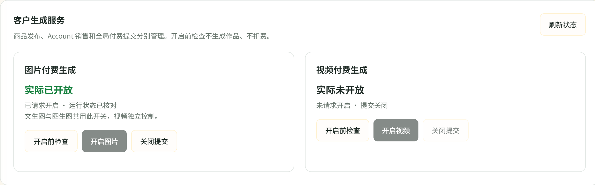
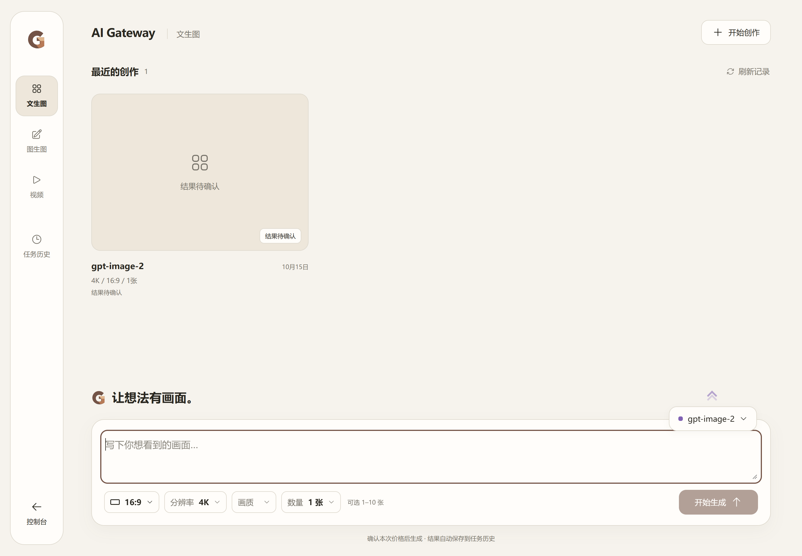
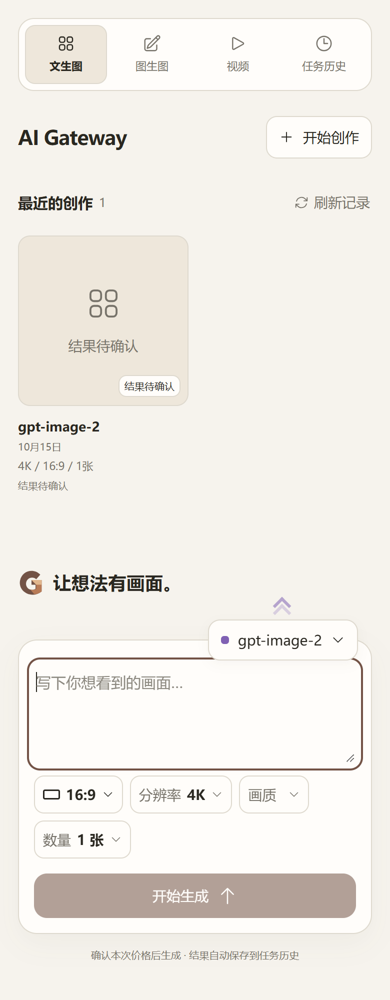

# 2bdbe3e8 生产部署结果

状态：**DEPLOYED_IMAGE_STATE_PRESERVED_VIDEO_DISABLED**。固定候选已部署；图片 requested/effective=true，视频 requested/effective=false。公网与登录后页面可访问。没有真实供应商生成或付费测试；本次上线不证明 Image2Pro 502 已解决。

## 固定产物与现场

- 运行源码：`2bdbe3e8d6f1c5a02dafca393484f457cf99cbf4`，完整Artifact `11949808833`，构建/验收Run `38684702740`；CI `38684683408`、Security `38684683411`沿用同源码PASS，没有重新构建。
- Manifest SHA-256：`1eeb32fa2edf72297aaa95da2b6bd24e4670dbd0bd65c34fbc1270f5b3140c51`。完整候选仅保留一份于 `D:/AI-Gateway-candidate-2bdbe3e8-final/`；本地与服务器TAR/hash/OCI-config对应均通过。
- 生产切换：北京时间 **16:23:27.437 → 16:24:04.580**，**37.143秒**；受保护验收完成16:27:28.916。第一份本次部署证据16:01:51起，至本报告约30.5分钟（不包含此前规则读取）；下载与上传占主要等待时间，不能把37秒说成总执行时间。
- 基础Compose：`/home/ubuntu/services/ai-gateway/phase5-launch-20261010-final-3bb336b/compose.json`。
- 生效overlay：`/home/ubuntu/services/ai-gateway/deploy-studio-entry-2bdbe3e8-20261015/compose.override.2bdbe3e8.json`，SHA-256 `80488b20c61e50866e150617fc450407165134e1725b75ca479cacb9daf6ae56`。仅替换三组件镜像；环境变量、managed-v1、挂载和服务认证配置未变。legacy图片/视频提交开关仍false。

| 组件 | config digest / Image ID | 服务器运行OCI manifest |
|---|---|---|
| core | `sha256:e860718a1a04e98ed0adf40a9a15750d6a6519e01efa39c9b8498f2e6a1c2a92` | `sha256:b395aa9c0e6e8877e9c7ab65af31403c144dc987d42225b3c0323db2f169896e` |
| bridge | `sha256:7b7cc6d5102c503a2f6290e86a36f786ebedbd1c7498c40f8d9a69d85d21617f` | `sha256:707c9d10b5f92fc90b4eca0218166dba89efe37991804b4f08acd25ba5e81cef` |
| bff | `sha256:b9bf09545ee3b0e6f428950b5f6ef0bfa6b58231ff67846813aa924012762c8c` | `sha256:419036b446058624174f8f46cfff4bbe206771818874dca1f84e9e6a123caf9a` |

上述两类摘要属于不同对象，已逐一核对OCI `config.digest`。三个运行文件SHA/大小与候选一致，见[结构化部署证据](deployment-evidence/deployment.json)。

## 生产非付费验收

- Core、Bridge、BFF全部healthy，sidecar均附着新Core namespace；PostgreSQL、Redis容器ID保持不变且healthy，Caddy active且配置不变。
- [管理员媒体工作台](https://laifufu.top/admin/media)、[客户作品桌](https://laifufu.top/video-studio)使用真实生产Core页面，1440px和390px均验证；17份实际加载JS/CSS的公网与源站字节相同，未使用Vite、fixture或API mock。
- 完整开启前检查：**1,870组合PASS**；浏览器1,362ms，服务端1,099ms。文生图与编辑原生报价、私有存储及依赖均通过。
- 授权恢复图片时服务端二次检查：**1,870组合PASS，983ms**。最终独立回读requested/effective均true；视频二者均false。
- 文生图及参考图编辑客户报价均HTTP200；4K/16:9/3张单价0.025 CNY，总价0.075 CNY；未提交生成。
- 原生凭据准备入口在生产真实Vue页面返回200，不要求手动创建Key。当前两名生产用户都已有Group31凭据，前后Key数量不变。**本次未制造零Key生产用户**；首次自动创建本人Key的证据来自同一2bd候选的真实三组件隔离验收，不能称为新生产零Key用户测试。
- 页面保留原unknown作品，文生图/图生图表单可进入、切换和编辑。没有调用可能恢复/结算旧任务的GET；浏览器拦截并记录一次页面原任务详情GET，不把该恢复路径标为本次生产验证通过。任务恢复及无重复POST/结算的行为继续引用同候选隔离证据。

## 业务保护与恢复

所有Account凭据/mapping及媒体配置指纹、Account77原1份商品、用户余额指纹、usage最大ID、视频订单更新时间均前后相同。三笔原unknown回执SHA全部保持。原生Key数量保持，视频管理记录保持。

293条迁移ledger摘要不变，无数据库迁移。未改商品/售价/销售标记/Account mapping，未删除任务、补扣或退款。仅执行获准的非付费报价、预检记录/存储检查和图片开启恢复。

回退资产：`/home/ubuntu/services/ai-gateway/deploy-studio-entry-2bdbe3e8-20261015/before`。原ac8923ab整组三组件镜像均仍可inspect；配置和环境快照私密保存。**未发生回退**。未来恢复仍需检查届时数据兼容及运行归属；不承诺有新业务后无条件回退，不恢复整库/Redis/journal/原片。

执行中本地迁移探针先使用原始字节摘要，发现与原生TrimSpace算法不同后校正，293条核对通过；未执行SQL。浏览器第一次Playwright截图20秒超时，业务预检已PASS；改用同一真实浏览器CDP截图后完成验收，没有重建/重新切换。公网PUB01/02/04/05/06及ART01通过；PUB03仅声明HTML资源引用对照，不宣称完整HTML字节相同。

## 实际生产截图

截图来自生产登录会话；1440/390为CSS宽度，设备像素比2。公开管理员截图仅裁取开关面板，排除个人账号/余额页眉；未修改页面状态或结果。

图生图与视频截图同目录。截图已人工检查，无重叠或横向溢出。空提示词时生成按钮保持不可提交是正常状态。

## 停止边界

部署完成，停止本轮操作。Image2Pro远端502最底层原因仍未证实，三笔历史unknown保持原样；新诊断保留能力已上线，但没有用真实付费调用验证供应商成功。视频#44准备缺口与原生迟到首次结算合同保持原状。Constraints原文未改。
