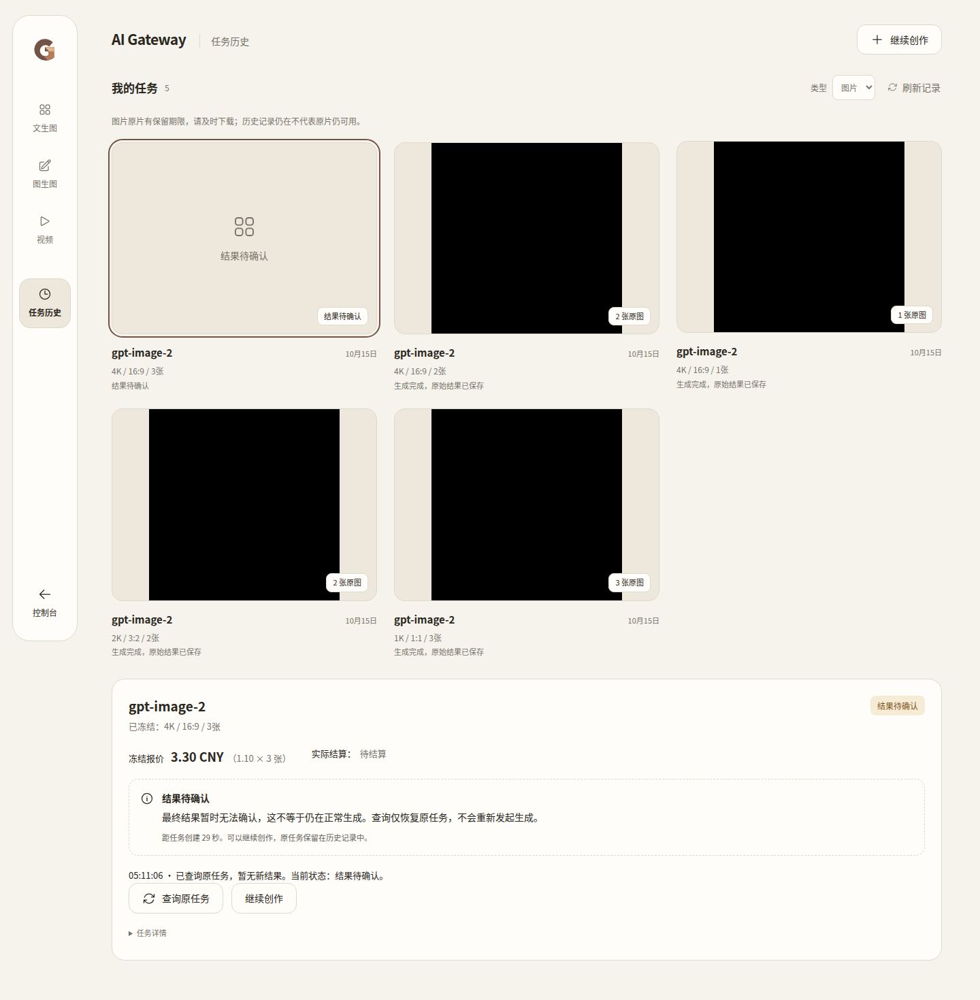
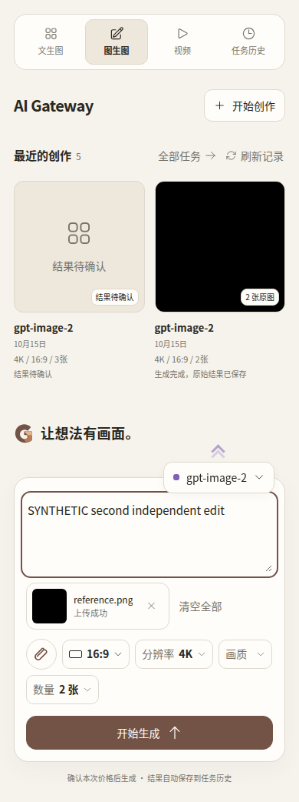

# 真实图片 502 与网页登录入口：本轮交接

状态：**CANDIDATE_READY_NOT_DEPLOYED**。A/B已完成定向修复及真实三组件隔离验收，未部署。生产仍为 `ac8923ab666a77acc3675024c286ff2effff9546`，本轮只读观察图片开启、视频关闭。没有供应商调用、生产业务写入或开关调整。

## A. 三笔真实请求

| 北京时间：原生请求开始 → 收到 HTTP 502 | 本站 Task ID | Core Request ID | 用户 / 客户 Key / Group / Account | 冻结规格、总价 | 本站外层耗时 |
|---|---|---|---|---|---|
| 04:47:22.424 → 04:47:47.458 | img_246553331bf3e4639ab4adbe94fcccc2 | bdfccad4-adb0-4c1c-a67d-f89c19fc9935 | 2 / 3 / 31 / 77 | 4K,16:9,3张,0.075 CNY | 25.348秒 |
| 11:40:57.511 → 11:41:37.291 | img_66c5f21b1cc78570f98ae244b7ce67a1 | 55bb1465-791b-4783-ab6c-822e3f19a710 | 2 / 3 / 31 / 77 | 4K,4:3,1张,0.025 CNY | 40.083秒 |
| 11:47:55.896 → 11:48:30.940 | img_f372e5916f913ebc4358129c65add930 | c49b9bed-0527-498e-ad5b-8819a2db4073 | 1 / 4 / 31 / 77 | 4K,16:9,1张,0.025 CNY | 35.350秒 |

三笔冻结的 Account 凭据/Proxy 指纹与当前 Account #77 一致，供应商 Key 尾号均匹配用户给出的 3c96；无配置 Proxy。持久化请求 payload 摘要一致，实际字段为 `model=gpt-image-2,n=3/1/1,resolution=4K,aspect_ratio=16:9/4:3/16:9`。接口为 `/v1/images/generations`。

本站原生转发确实调用了 HTTP 上游并收到 502，不是图片 Bridge 没有发送请求。每笔只有一个执行单元和一次本站原生发送证据；请求不可自动重放，也没有换 Account 重试。不能据此证明供应商内部只有一次调用。

供应商后台的结束秒、模型、张数、Key 尾号与上述事件强关联，且本站保存的完整凭据指纹相符。但历史没有保存可与供应商记录共同核验的上游 Request ID，不能把这组旁证说成已严格逐笔确认。供应商“使用人数过多，请重试”“积分已退还”为用户提供的后台证据；本站没有可靠单笔供应商查询 API，未用余额变化推算退款。

供应商所示19.10/33.79/31.27秒与本站25.348/40.083/35.350秒属于不同计时范围。实际收到502时未触及Bridge16分钟/BFF960秒/前端60秒超时；Core当前OpenAI response-header timeout=0，没有本站响应头超时证据。不能确定502由供应商网关、内部中转或底层生成服务哪层产生；“人数过多”不是最底层根因证明。

### 客户资金与 unknown

- 第一笔复用已核实的原生资金报告：本站实际结算0，无客户预扣或占用。
- 两笔新任务分别匹配原请求/派生计费身份：usage、dedup、dedup_archive均0；receipt为unknown/billing pending，执行单元unknown，无响应字节、原片或交付摘要；没有调用结算的前置交付条件。
- 同时检查对应Redis inflight预算与精确请求身份，余额占用为0；无prepared transaction/长期数据库事务。不是只凭usage=0得出结论。
- 11:41任务的用户余额更新时间早于请求；11:48管理员的当前余额更新时间晚于任务，缺少该笔请求前的余额快照，不能把管理员全账户期间余额变化全部归因于此任务。
- “冻结报价”不是冻结客户余额。unknown保留原任务，未来若有可靠结果仍可能发生原生首次结算；这不是本轮修复掉的合同。

没有可靠终态回执时继续保留unknown，不把502或后台提示强行转换为可自动退款/删除的终态。本轮没有调用可能写入或结算的任务恢复接口。

### 已确认的本站缺陷与修复

`StudioImageRuntime.dispatchHTTP`创建独立Gin context承接原生ForwardImages响应；原生层已经解析了脱敏错误消息、HTTP状态、Account、耗时与请求ID，但这些Ops字段留在子context，外层只记录409 `studio_image_binding_unavailable`。历史Ops行32/33中的Account/upstream status/message为空，无法回补当时已丢失的正文。

最小修复：将已有Ops字段白名单及事件复制回原请求context，将可用上游Request ID保留到既有单元回执。身份、客户响应writer和原始供应商正文不复制；继续使用原生脱敏与Ops落库，不新增监控/账本/任务表。502仍unknown，不自动重发，不宣称供应商容量问题已修好。

## B. 网页与原生 API 入口

已保留：JWT → `/auth/studio-media-ticket` → 单次ticket交换 → HttpOnly Studio session；会话Owner与JWT用户一致，账号切换不复用旧Owner。Bridge依据服务器配置的Group查用户自己的原生Key；Core仍校验Key/User/Group、Account归属、模型权限、Published Offer、冻结报价和原生结算。

发现缺口：Bridge原来只读取已有Key；无Key新用户会被拒绝。旧隔离`customer-keys.mjs`预先创建Key，因此不能作为“新用户只登录即可用”的证据。这与三笔502不同：三笔已有有效Key，并已到达上游。

最小连接：受JWT保护的`POST /api/v1/keys/studio-access`只接受media，用户来自认证上下文，Group来自已有受服务认证的Bridge运行状态。复用APIKeyService.Create、原生Group/订阅权限及创建限额，为零Key用户准备本人独有原生凭据，不返回密钥。当前唯一Core实例对同一用户/Group并发首次进入合并；不声称新增多Core分布式幂等合同。

已有同Group凭据无论停用、过期或额度耗尽都不替换，不通过新Key绕过限制。实际访问继续由原生认证决定。前端在目录、readiness和创作准备入口调用。历史查询、恢复与下载API本身不创建凭据，仍用原任务冻结Key；进入整个工作台页面同时加载目录/状态时可能执行首次准备。原生API/SDK用户保留原有自助Key管理。

## C. 视频准备

#44准备方案继续保留，仍缺真实采购成本、正数售价和当前模型权益确认。未改Group31成本、商品/发布、图片状态或视频开关。成本/Group变更可能使现有图片预检指纹失效，后续生产配置需单独明确范围。

### 成品补验发现并修复的首次进入竞态

首次45f92候选中，目录已接入准备凭据，readiness仍并行直接请求；零Key客户初次进入时readiness先失败，随后目录与报价成功，但UI仍保留“生成服务尚未开放”。这不是生产开关被改动，而是该未上线候选的一处接线遗漏。候选38681764254因此FAIL，不能部署。

修复让目录、readiness都先等待原生凭据准备，服务端按用户/Group合并并发创建；不修改真实开关、不用刷新页面作为绕过。新增可复现竞态的前端测试PASS。验收脚本同时修正Promise等待的异常捕获，失败能保留现场证据；不延长业务超时。该次修复运行源码为`aa406974d303cfd4e548d247f45295e26fc89780`。

### 成品数据库核验补齐原生 Account 归属

aa406974最终镜像中，零Key客户文生图3张、参考图编辑2张、普通单视频、unknown后的继续创作与查询反馈已通过。新增原生Ops数据库断言发现错误事件内Account存在，但顶层Account为空；原生网关handler在转发前调用setOpsSelectedAccount，Studio入口漏接该步骤。

最小补充4行：从已经冻结的Quote取得Account与SiteModel，复用setOpsRequestContext / setOpsSelectedAccount后执行原Dispatch。无新Account查询或选择，不改变冻结身份、模型映射、扣费及HTTP响应。Run38682785352仍判FAIL/NOT_PASSED；不能以局部业务通过掩盖诊断验收失败。该次源码为`42e11046c7727369ac73f82b3bc4472259fb4fd0`。

### 原生错误正文的字符串形式

Run38683764536证实顶层Account、HTTP502与请求身份已正确落库，最后一个断言发现模拟响应`{"error":"synthetic_upstream_outcome_unknown"}`的文字被原生解析器遗漏。原生解析此前只读error.message/detail/message。本轮给原生extractUpstreamErrorMessage补上字符串error的末级回退，保留现有字段优先级；对象、数组、数字或HTML不整体复制进错误消息。已有脱敏、HTTP状态、unknown、禁止重发与资金行为不变。

9种正文/优先级用例覆盖该缺陷；真实三组件仍使用原字符串502样本，不通过改成更容易解析的模拟正文掩盖问题。历史三笔原始正文已丢失，不能反过来断言它们也是此种JSON形式。

## 验证及冻结版本

- A修复提交：`cefdb2a6ed461f44a43d74ef8ea34e85d019c043`。其Go unit/integration通过，初次CI仅三个测试type assertion的errcheck失败，后续提交已修正；Security PASS。
- A+B初始源码：`45f92ca4dc25aeb96df0e0e16f5472909d2ef8b7`；最终运行源码：`2bdbe3e8d6f1c5a02dafca393484f457cf99cbf4`。
- 本地前端入口12项定向测试PASS；本地Go受Windows虚拟内存不足限制，未伪报PASS，使用现有GitHub-hosted CI。
- 初始运行源码CI38681463141、Security38681463180均PASS；aa406974 CI38682764390、Security38682764314均PASS；42e11046 Security38683746534 PASS；最终2bdbe3e8 CI38684683408、Security38684683411均PASS。Go unit/integration、golangci-lint、前端类型/Lint/测试及现有浏览器CI通过（主前端42文件736项、向导17项浏览器；不将其替代真实候选联调）。原生仓储PG集成27.517秒、service集成135.908秒；具体命令/包结果见evidence/ci-test-summary.txt。
- 初次成品脚本`6ce2fd4a629c28c081d8b83318884f406cf64e55`，Run38681764254失败，完整artifact11948318841为NOT_PASSED。aa406974 Run38682785352因Ops顶层Account字段缺失FAIL。42e11046 Run38683764536因字符串错误信息遗漏FAIL。最终运行/脚本同为`2bdbe3e8d6f1c5a02dafca393484f457cf99cbf4`，Run38684702740 PASS。真实三组件、PostgreSQL、浏览器，客户零预建Key；只替换模拟上游。跳过既有104笔和1870组合，保留前次证据。
- 本轮无生产部署；最终镜像、CI、安全均通过，本地已核对证据和截图。可提交单独部署审批，但不证明真实Image2Pro未来生成必然成功。

只读证据：`production-readonly-evidence.json`。其中敏感原文、密钥、提示词、私有结果地址不公开；私有证据文件只记录摘要，原件留在本地忽略目录。

## 发布守卫范围

本轮环境仅GitHub-hosted隔离组合，页面来自Core嵌入资源；无生产切换。生产目标仍是https://laifufu.top，部署须另批。

| 门槛 | 本轮状态与证据范围 |
|---|---|
| PUB-01 HTTPS/跳转 | N/A于隔离loopback；新候选生产HTTPS尚未部署验证，不能沿用旧线上PASS作为本次新版本结果 |
| PUB-02 边缘安全挑战 | N/A于隔离环境；生产Cloudflare未改动/未做发布检查 |
| PUB-03 边缘改写 | N/A，本轮没有边缘代理或HTML注入变化 |
| PUB-04 本次页面资源 | PASS（隔离）：task-experience报告的assets记录核对Core实际资源；桌面1440和手机390截图已人工检查。生产新资源UNKNOWN且未切换 |
| PUB-05 健康与关键功能 | CI PASS；最终三组件和浏览器联调Run38684702740 PASS，不以CI替代成品结果 |
| PUB-06 失败证据/恢复 | 首次候选错误日志、确认页截图及NOT_PASSED manifest保留；未来生产回退以当次核实ac8923整组三组件/配置为准，当前未执行回退 |
| ART-01 真实产物 | PASS：evidence/manifest.json、runtime-files.json及acceptance.json对应同一2bdbe3e8源码；TAR与OCI/config关系由云端导出验证，本地未重复下载TAR |

迁移文件相对ac8923无变更。下一次部署需核对现网、私有存储/网络、服务认证、managed-v1及回退条件；首次无Key用户进入会创建其本人原生Key，这是本次新增预期行为。已有三笔unknown与已保存商品不改写。图片重启后是否恢复原开启状态需纳入明确部署授权，视频继续关闭。

## 最终候选身份与交付

- 分支：codex/media-paid-controls。运行/构建/验收脚本：`2bdbe3e8d6f1c5a02dafca393484f457cf99cbf4`。后续文档归档提交不是运行源码。
- [构建与成品验收38684702740 PASS](https://github.com/maximeblen654-boop/AI-Gateway-public/actions/runs/38684702740)。
- [CI38684683408 PASS](https://github.com/maximeblen654-boop/AI-Gateway-public/actions/runs/38684683408)；[Security38684683411 PASS](https://github.com/maximeblen654-boop/AI-Gateway-public/actions/runs/38684683411)。
- [manifest](evidence/manifest.json) SHA256：`1eeb32fa2edf72297aaa95da2b6bd24e4670dbd0bd65c34fbc1270f5b3140c51`。每组件来源均为上述冻结源码，linux/amd64；不是复用旧镜像后改标签。
- 完整镜像Artifact：`11949808833`，名称`native-media-candidate-2bdbe3e8d6f1c5a02dafca393484f457cf99cbf4`，211837178字节，2026-10-29 05:11:29 UTC（北京时间13:11:29）到期。
- 小证据Artifact：`11949474388`，9927537字节，2026-10-29 05:11:27 UTC到期。GitHub artifact为14天临时保留，不称永久备份。
- 本地只下载一份小证据：`D:/AI-Gateway/output/studio-entry-2bdbe3e8-final/`；没有下载最终完整TAR，也没有在本机重复构建。需要部署或长期归档时，在到期前取回该准确Artifact一份即可。

| 组件 | config digest / Image ID | TAR SHA256 |
|---|---|---|
| core | `sha256:e860718a1a04e98ed0adf40a9a15750d6a6519e01efa39c9b8498f2e6a1c2a92` | `98bddf03218d92aa541b69c3dc7f127fb0dd15581981c4be1be379aae4a06608` |
| bridge | `sha256:7b7cc6d5102c503a2f6290e86a36f786ebedbd1c7498c40f8d9a69d85d21617f` | `70ef76555f40b15c3babe0929128aac3fcaff782ffc0920816866a46a65850e7` |
| bff | `sha256:b9bf09545ee3b0e6f428950b5f6ef0bfa6b58231ff67846813aa924012762c8c` | `38138a730c9b33406d7766b862c97a5acd684d4735c0ec60bbb758e15e872881` |

每个TAR实际文件名、OCI manifest→config.digest关系、程序SHA和组合网络/挂载详见manifest、runtime-files、combination。combination仅隔离配置，不能复制到生产。旧45f92/aa406974/42e11046候选均未完整通过，不可部署。

## 最终隔离证据

- [零Key入口与原生Ops落库](evidence/native-studio-entry.json)：初始keys=[]；客户2最终仅有本人Key3/Group4、Key4/Group3，分别匹配服务器配置；没有手工建Key、没有客户端选择Group。已有受限Key不替换，原生权限及限额仍可拒绝访问。
- 真实502落库：Account3、HTTP502、upstream_latency_ms=3、`synthetic-studio-unknown-502`，原字符串错误消息保留。仅模拟上游数据，不是生产订单回填。
- [文生图](evidence/native-customer-image-geometry-1k.json)：1K/1:1/3张，正常单图拆批3个生成单元；[编辑](evidence/native-customer-edit-geometry-2k.json)：2K/3:2/2张，两次单图单元，私有参考图、冻结报价与原片摘要一致。按既有合同一次任务原生结算一次，正常拆批不算重发原单元。
- [单视频](evidence/native-customer-video-compatible.json)：普通兼容提交/查询/交付及原片摘要通过，未触及真实供应商。
- [unknown与独立新任务](evidence/native-task-experience.json)：502零结算，保留unknown；查询加载/时间/失败反馈、继续创作、刷新/重新登录、两个独立新任务及原生结算通过；查询/下载不增加生成或扣费。
- [开关保护](evidence/native-paid-controls-verify.json)：付费关闭时文生图/编辑非付费报价、原生资金不足、权限拒绝、mapping依赖变化、BFF不可用、图片视频隔离均PASS；[测试结束关闭](evidence/native-paid-controls-close.json)。没有在生产重复执行。
- [运行健康与网络](evidence/acceptance.json)：三个最终镜像healthy，Bridge/BFF附着同一Core网络namespace。
- 人工查看下列最终镜像截图：桌面任务和查询信息清晰；390px图生图提示词、参考素材、规格及生成按钮可见，无重叠/水平裁切。黑色结果是模拟器1×1 PNG，用于交付摘要验证，不是供应商成品效果。

本轮由原线程串行完成修改与最终集成，无两个独立项目或并发共享文件写入。主工作区既有脏改动保留；正式Handoff只追加新阶段事实，Constraints原文不变。

下一项需要用户审批的生产动作只有：部署上述固定候选，并明确包含managed-v1重启后在完整非付费预检通过时恢复原图片开启，视频继续关闭。旧任务不重发/删除，不修改商品/售价/mapping/余额；真实付费测试不属于该部署动作。若不批准部署，就保持本次候选和当前生产不动。
