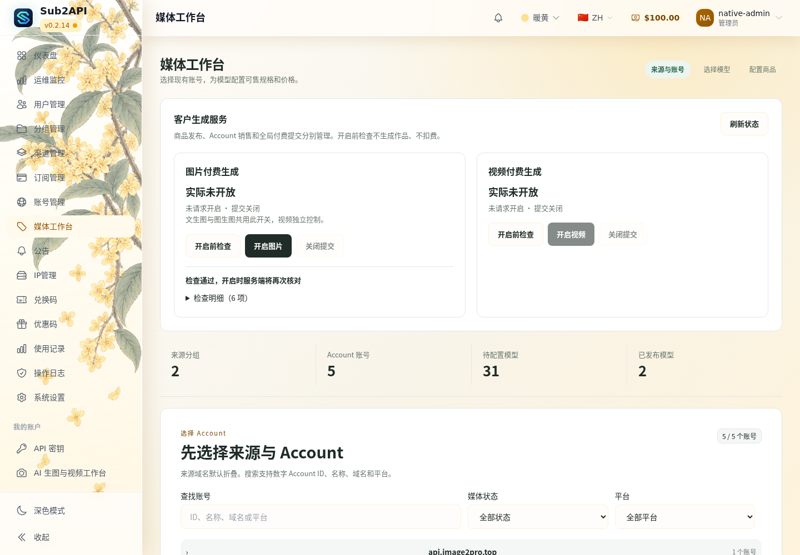
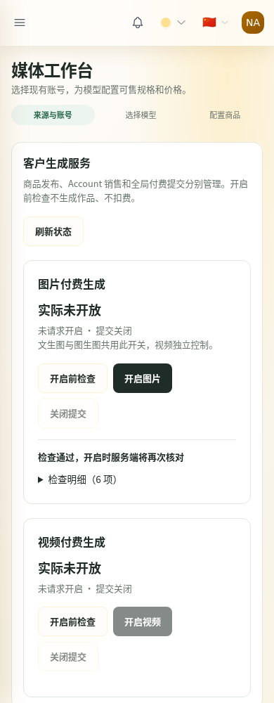

# 已发布目录依赖恢复：候选交接

状态：**CANDIDATE_READY_NOT_DEPLOYED**。本轮仅生产只读、隔离开发和候选构建；没有生产发布依赖写入、部署或开关操作。最新核实生产仍 `4f10be20ef06bc0a7670822e88eefd60c53d09c9`，图片 requested=true/effective=false，视频 false/false。

## 原因与已经完成的修复

Account #77 的旧目录为46模型，当前53模型，新增7项且同步时间改变；没有删除GPT模型。原目录原生摘要准确匹配旧Published。原实现将完整Catalog（包括同步时间、所有模型和顺序）计入Published依赖，导致无关变化也失效。不是Banana不支持，也不是草稿没保存：当前GPT+Banana两产品Draft已保存，revision校验PASS、3570个草稿组合；Published只含原GPT。

新代码保留Draft/CAS的完整依赖；新Published仅对其引用模型的目录成员关系取版本化摘要，完整mapping、routing、binding和registry仍参与。真正模型删除或映射/路由/协议变化继续拒绝。旧Published读取不静默迁移；必须显式恢复。无数据库migration变化。

普通运行链仅修改 `adapter.go`、`media.go`、`studio_paid_preflight.go` 的依赖选择。一次性恢复通过 `published_recovery.go`、`repository/media_published_recovery.go`、`cmd/media-published-recovery/main.go` 复用原生校验。无新HTTP发布入口、任务平台、配置表或结算逻辑。

## 原GPT隔离恢复结果

[真实只读投影的原生离线证明](offline-native-proof.json)覆盖全部1870规格，581ms。使用原Published.Products，不取两商品Draft；产品/Offer ID、规格、绑定、售价及Draft/Validation全部相同。每张0.025 CNY，3张0.075，10张0.250；参考图0/1/16分别验证。产品和Offer摘要及前后Dependencies、revision均在证明中。原件私有投影不提交GitHub。

恢复工具固定Account77和原GPT，默认dry-run；事务行锁、受控版本/全行SHA与配置SHA比较、原件新文件备份/fsync、原子Published+record_version写入、提交前摘要复核。真实隔离PostgreSQL测试通过：dry-run不改、备份失败回滚、过期计划拒绝、成功只改白名单字段、重复旧计划拒绝。不会覆盖用户两商品Draft、Validation、Sales或其他Account字段。

[唯一生产恢复方案](RECOVERY_PLAN.md)描述追加授权范围及顺序。基于本轮读取，预期record_version32→33；新Published revision：`mwp_9c5f3bc01007b9372219a8e2fbb9a0a1d25a4d49a083a584d8359da6b889be6f`。实际执行前须重新核对现场并固定dry-run计划，漂移即停止。

## 固定候选与验证

- 运行源码、构建/验收脚本：`3b4a44ec881c6d4954ac2b9bb56973b5d80bf88c`，分支 `codex/media-paid-controls`。
- [候选 Run 38797352846](https://github.com/maximeblen654-boop/AI-Gateway-public/actions/runs/38797352846)：PASS。
- [CI 38797295333](https://github.com/maximeblen654-boop/AI-Gateway-public/actions/runs/38797295333)：PASS（单元、PostgreSQL集成、Lint、前端与既有合同）。
- [Security 38797294947](https://github.com/maximeblen654-boop/AI-Gateway-public/actions/runs/38797294947)：PASS。
- [完整镜像 Artifact 12002918453](https://github.com/maximeblen654-boop/AI-Gateway-public/actions/runs/38797352846/artifacts/12002918453)，244,009,454 bytes；含三镜像、维护工具、报告。UTC 2026-10-29 20:06:02（北京时间10月30日04:06:02）到期。
- [小证据 Artifact 12002574061](https://github.com/maximeblen654-boop/AI-Gateway-public/actions/runs/38797352846/artifacts/12002574061)，12,557,017 bytes；北京时间10月30日04:06:00到期。ZIP SHA256 `475bd08cc98a3a99733d854ccce2bffd49ec403d1f5d1eb813b7e9506d6845c2`。
- [最终PASS manifest](manifest.json)，SHA256 **`f73252cb64c2b26d963345c061cdeb0d901d8b762ed87aacb300941c4d038562`**。
- 三组件均为此次源码构建，linux/amd64；未冒用15da身份。旧15da未部署，新候选包含其已验收功能。
- 本地只取一份小证据：`D:/AI-Gateway/output/published-catalog-recovery/final/`。完整镜像仅保留GitHub该一份，未向C/D重复下载；临时artifact不是永久备份，后续授权执行时应在到期前按既有归档方式取一份。

|组件|Image ID / config digest|TAR SHA256|
|---|---|---|
|Core|`sha256:015b9e2314faedf7fbc7187459084840dcdf33993ff798c83a970f0b7bbaf6d5`|`46d3e6064b9a3a871e7ff0d96fe8987ab1b519425b0a0982e1a288ee3e64fead`|
|Bridge|`sha256:aadb2d61867cc52c7be1d3e0aafd9c6f789fc302eec114a94864353c5d1c1330`|`fa53e62cf50ac304ee54536ee20db0c5cbf578453142a4a9d91b6e9833970fbb`|
|BFF|`sha256:bc65c5733f518492f60f81b1a04591c629a0fc742872efae5664d4569ae69bc5`|`cf19830b4432a6ee39d9b69efb9b95129e728e066f1bf20bf53c6a009924991d`|

TAR文件名、OCI manifest→config关联见manifest；不将OCI清单摘要与config digest混为一物。[维护工具指纹](maintenance-tool.json)：`80ca859e6f0608ce8167d2d5005ad075445e777f23edf55011494734f430255a`，只打包，未在生产执行。[运行文件](runtime-files.json)、[隔离组合](combination.json)、[最终健康](acceptance.json)可核对；组合含模拟证书和测试配置，严禁用于生产。

## 最终镜像隔离联调

[脱敏测试汇总](verification-summary.json)：实际Core内置前端+Bridge+BFF+PostgreSQL+Redis+模拟供应商，无Vite、无浏览器API mock。

- 1870全量检查3次，浏览器864/736/589ms，服务端497/651/526ms；正式启用动作的二次检查1870，浏览器697ms、服务端576ms。
- 同步时间、无关模型新增、模型顺序改变：授权指纹和图片有效状态不变，文生图/编辑0、1、16参考素材报价均200且售价相同，全部商品配置不变；这些目录/报价检查供应商调用增量0。
- 删除GPT：有效状态关闭，预检失败，报价409；恢复目录仍不自动开启，必须新预检+显式开启；视频保持关闭。mapping/routing/协议变化、legacy严格校验、取消、非法配置、冻结报价和视频共用解析由定向Go及集成测试覆盖。
- 既有文生图多张、编辑、单视频、原片摘要与一次原生结算通过；20笔定向异常（成功/502/部分502/断线/超时各4笔）及重启/重复查询通过，未重复104笔资金全套。
- 15da比例按钮、自定义保存/未发布拒绝、模型中性状态与桌面/手机相关回归继续通过。

以下截图来自最终候选合成环境，不是生产：

## 发布守卫适用性与剩余授权

|门槛|本轮范围/结果|后续生产要求|
|---|---|---|
|PUB-01～04|N/A：本轮无生产切换/HTTPS或缓存改动|获授权部署时检查实际HTTPS、边缘、版本及静态资源，不用候选PASS替代|
|PUB-05|PASS（隔离）：三组件健康、网络附着及真实后端合同；生产新版本未验证|部署后重验生产健康、1870、非付费报价|
|PUB-06|PASS（隔离准备）：故障反例、备份失败/过期CAS保护及限定恢复方案|生产切换前重新固定现场回退资产；发布依赖写入后不可盲回旧镜像|
|ART-01|候选运行程序/资源身份、实际启动与业务验证PASS；精确运行文件大小/摘要已封存|生产既有受控发布验证器须按相同冻结产物再次验证，未宣称本轮已执行生产守卫|

旧4f/15da能解码新摘要，但不认可新语义，会拒绝报价；因此**唯一建议是新候选先部署，再受控重验并仅恢复原GPT发布依赖，最后完整预检后条件恢复图片**。不能先将新摘要写入旧4f后强开；也不能拿旧15da解决持久问题。

需要用户追加一次明确授权，涵盖：部署本页固定新候选；Account77白名单维护仅更新原GPT Published的Dependencies/Revision/PublishedAt及CAS record_version；全量非付费检查通过后恢复图片requested/effective=true，视频false/false。不包含Banana发布、Draft/Validation改写、价格/mapping/资金/历史任务变更或付费生成。原15da部署授权不自动扩展到这些动作。

本轮未执行上述生产操作。正式Handoff按证据追加阶段事实，Constraints原文保持不变。更早失败/取消的开发run不是交付候选，最终仅以上3b4及PASS manifest有效。
