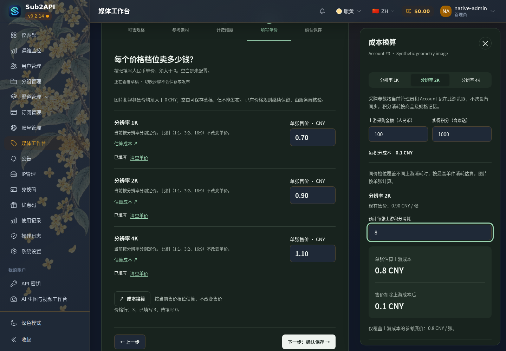
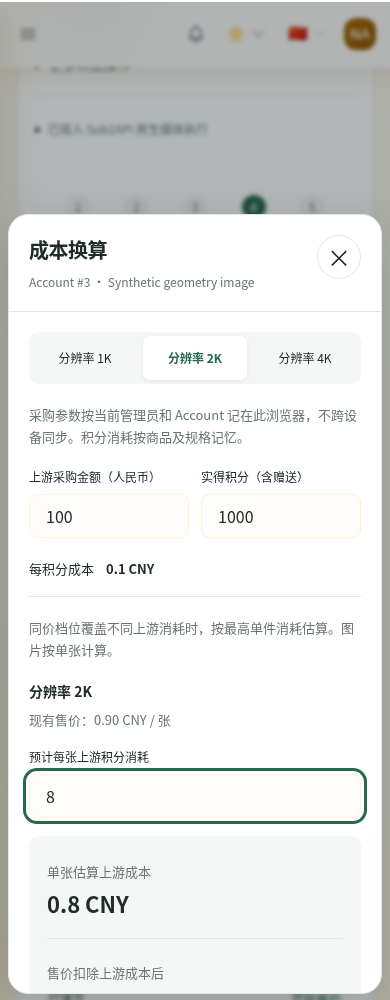

# 管理员媒体工作台：最终运行候选

**CANDIDATE_READY_NOT_DEPLOYED**。正式 Vue、实际 Core/Bridge/BFF 与隔离数据库联调通过；未连接或修改生产，没有真实供应商请求或实付。

## 冻结身份

- 分支：`codex/admin-media-design-review`；[PR #1](https://github.com/maximeblen654-boop/AI-Gateway-public/pull/1)。
- Core 运行源码：`15d09689abc0b7e07269692d50e78f83859d1fb6`。
- 正式 Vue 实现 `64cc40c4f06dbedd51f748fb9a52a83e99256479` 与后续验证 `f246974afaedf5a3d143bde57cee4378ddf87372` 均包含在该源码中。因本轮新增“图片和视频售价均须大于 0”的明确规则，原来允许图片零价的代码需作最小准入修复，不能把旧 f246 镜像标成符合新规则。
- Bridge/BFF 精确复用：`b2fcdac93afa6ae194ee81801a9b37813f8f39eb`。
- 构建脚本：`15d09689abc0b7e07269692d50e78f83859d1fb6`。
- 最终验收脚本：`5c8ee1d4af6fd4e4ea6686e43332049cc0aca218`。15d 之后只改变三个 Go 测试文件及候选验收脚本/workflow，运行源码、依赖锁和组件配方没有继续变化。
- [最终 PASS manifest](candidate-evidence/run-38541341605/manifest.json) SHA-256：`9741cb3cec6406354bd1ec829035c9a7746063f8ea802d3ed0707d7a51c26086`。
- 完整本地归档位置：`D:/AI-Gateway-candidate-15d09689a-final/`。使用最终补验 manifest；原构建 manifest 另存，TAR 字节不变。[本地归档复算](candidate-evidence/run-38541341605/local-archive-verification.json)全部 PASS，仅保留一份完整本候选。

| 组件 | Image ID / config digest | OCI manifest digest |
|---|---|---|
| Core（新建） | `sha256:c1496ec64f21dc2a4d7539734f36aa07579feab7f00eba8790bb3620cf4a35a3` | `sha256:707da370b94f85ec548a0eae4b11f8648016d1262bfdd792bb0c800da6d77ef5` |
| Bridge（b2 复用） | `sha256:dd01aa29e152f589679e5065037459240aeb8ddfe3ec853c16033006fe67acda` | `sha256:caa90294c79db4253b8cdb97bb920a255afc9c3797555d0c18d55e6a7ffc9e25` |
| BFF（b2 复用） | `sha256:e498b97225bfc15e286af26bff30ec5c8d84526adfdbcd8231ebf7bad50e3f21` | `sha256:cc7ae2120821e12ef687847408718bc2547c2f12ab9c05b2dd6609bb41e0344a` |

全部为 linux/amd64；已从 TAR 的 OCI 清单检查 `config.digest` 与 Image ID 的关系。

| TAR | SHA-256 | 字节数 |
|---|---|---:|
| `core-15d09689abc0b7e07269692d50e78f83859d1fb6.tar.gz` | `2b575e179084d58af2c8b63219ec9b048d1193fd9d9a39292d33cdbca8c66e0e` | 61950821 |
| `bridge-b2fcdac93afa6ae194ee81801a9b37813f8f39eb.tar.gz` | `30ba9310b18f1da057d9d7515d5d4eddea15c32077c234c848a2cbf36c9b4b35` | 19126414 |
| `bff-b2fcdac93afa6ae194ee81801a9b37813f8f39eb.tar.gz` | `29a1da9fa2ee0229cc352a0bbda2dbaa11735f80f291f65dc7f36a8dac6402f7` | 120269341 |

[复用依据](candidate-evidence/run-38541341605/reuse-proof.json)：studio、deploy/studio、依赖锁、组件 Docker 配方及 Bridge 实现保持一致；差异仅为 Core 的价格准入与对应测试。Bridge 将目录、报价和提交交给 Core 校验，不执行本次改变的发布校验。实际组合验证了 b2 原二进制，未重新构建 Bridge/BFF。组合网络/挂载记录在 [combination.json](candidate-evidence/run-38541341605/combination.json)，明确是隔离配置，不能复制到生产。

## 构建、验收与测试

- [构建 Run 38539809920](https://github.com/maximeblen654-boop/AI-Gateway-public/actions/runs/38539809920)：Core 构建及三组件封存步骤 PASS；整个首次 run 因新验收脚本取错视频请求而 FAIL，不能报告为全绿。实际构建 3 分 34 秒，封存 9 秒；没有重建补验。
- 完整 Artifact **11882680877**，名称 `native-media-candidate-15d09689abc0b7e07269692d50e78f83859d1fb6`；到期 **2026-10-28 09:12:08 UTC**。
- [最终验收 Run 38541341605](https://github.com/maximeblen654-boop/AI-Gateway-public/actions/runs/38541341605)：**PASS**。下载上述原包，复算三个 TAR，docker load 后检查完整 Image ID、平台和 source label；没有 docker build/save 或重新导出 TAR。
- 最终小体积证据 Artifact **11882812063**，名称 `native-media-existing-acceptance-5c8ee1d4af6fd4e4ea6686e43332049cc0aca218`；到期 **2026-10-28 09:21:18 UTC**。GitHub 的 14 天 artifact 不是永久归档；最终 manifest 和证据保存在本目录，完整镜像另存一份。
- [验证提交 CI 38540092049](https://github.com/maximeblen654-boop/AI-Gateway-public/actions/runs/38540092049)：全部 PASS；与运行源码相比只有测试修正，运行代码相同。前端类型/关键单测/浏览器、BFF 合同、Go 单元与 PostgreSQL 集成、Lint、发布辅助及 shell 检查通过。
- [最终脚本 CI 38541319551](https://github.com/maximeblen654-boop/AI-Gateway-public/actions/runs/38541319551)：全部 PASS；[精确提交及逐 job 结果](candidate-evidence/run-38541341605/ci-status.json)。
- [运行源码 Security 38539782940](https://github.com/maximeblen654-boop/AI-Gateway-public/actions/runs/38539782940) 与 [最终脚本 Security 38541319603](https://github.com/maximeblen654-boop/AI-Gateway-public/actions/runs/38541319603)：PASS。
- 本地：mediaworkbench Go 测试、2 个定向前端文件共 24 项、vue-tsc、相关 ESLint、脚本语法及 diff 检查 PASS。大型构建和真实隔离运行全部在 GitHub-hosted runner。

首次脚本以模型名寻找视频请求，错误取到模拟器的 `/v1/responses` 能力检查；该请求没有视频规格，Core 正确拒绝 409。修正为同时匹配 POST `/v1/videos`、模型 ID，并断言唯一提交及 duration/resolution/ratio。原单视频业务本来已通过；修正仅涉及验收脚本。首次证据保留在 [first-attempt](candidate-evidence/first-attempt/)，完整测试采用同组原镜像补验通过。

## 实际业务结果

页面全部来自最终 Core 的嵌入资源；没有 Vite、prototype 或浏览器 API mock，4295 无开发服务。浏览器取得的管理员/客户关键 JS、CSS 与 Core 直连资源逐字节校验。[/app/sub2api 等实际文件指纹](candidate-evidence/run-38541341605/runtime-files.json) 与 [健康/网络/挂载](candidate-evidence/run-38541341605/acceptance.json) 均已记录。

| 范围 | 实证与结论 |
|---|---|
| Account → 模型 → 商品 | 正常五步 UI 保存两个独立商品，数据库重读与保存请求一致；canonical mapping 保留，第二商品 ID/规格/价格不被另一商品修改。 |
| 规格完整链 | 1K/2K/4K、比例、参考图和数量经 Draft → DB → Validate → Published Offer → Quote → 实际模拟请求保持一致。没有预填 size_mappings，也没有前端 K→像素推断。合法历史 mapping 仍兼容；比例/像素冲突仍拒绝。 |
| 64 条预览 | 64 个样本都为 1K，4K 不在样本中；4K/16:9 仍从完整能力报价并执行。价格矩阵依据 capabilities/rules，非 previews。 |
| 空白/0 元售价 | 图片、视频分别保存 null、0、0.00000000；原输入不改，发布均 422 且 Published 不变。结构完整的旧零价 Published 不进入可执行目录，Quote/Generate 均 409；生成与账务增量 0。 |
| 正价 | 图片/视频 0.01、1、9.9 均 Publish/Quote 200，保留原金额；正常正价生成见下表。没有把 0 静默改成 0.01。 |
| 历史数据 | 新发布/报价/执行准入要求正价；旧零价回执算术仍可读取，未改写历史或重定价。 |
| 冻结依赖 | 用户确认的原合同保留：未发布草稿改价和改执行上限，旧报价仍用原价/原计划；已发布、mapping、routing 变化分别 409，原任务只恢复查询，上游及账务增量 0。 |
| 发布边界 | Account 级发布范围、二次确认、草稿不自动发布、销售单独控制均保留；隔离点击发布后取消不会改变 Published。 |
| 成本计算器 | 仍使用原 MediaCostCalculator/costCalculator.ts；身份/Account/商品/稳定规格键隔离和存储降级既有测试保留；实际保存载荷不含采购/积分字段，已有售价不变；[离线交叉核对](candidate-evidence/run-38541341605/calculator-isolation-cross-check.json)也确认 DB 商品、Published Offer、客户报价/提交与模拟请求未携带计算器字段。消耗 0 是估算值，不会绕过客户正价校验。 |

| 模拟成功场景 | 实际上游参数及次数 | 冻结价与结算 |
|---|---|---|
| 文生图 | 1K / 1:1 / 3 张；3 次 n=1 | 0.70 × 3 = 2.10 CNY；usage +1 |
| 参考图编辑 | 2K / 3:2 / 输出 2 张、输入 1 张；2 次 edits | 0.90 × 2 = 1.80 CNY；usage +1 |
| 超出预览 | 4K / 16:9 / 1 张；1 次 generation | 1.10 CNY；usage +1 |
| 普通兼容视频 | 720p / 16:9 / 5 秒 / 1 条；1 次 `/v1/videos` | 整条 2.00 CNY；usage +1，capture +1 |
| 只改草稿后执行 | 2K / 3:2 / 3 张，仍是原三次单图，非新草稿2+1 | 原价 0.90 × 3 = 2.70 CNY；usage +1 |

所有成功场景：原片摘要相符；刷新/查询/重复下载不增加上游生成、扣费或结算。视频真实元素可播放模拟蓝色短片。图片是合成单像素字节，不用于评价画质。机器证据：[contract-cross-check.json](candidate-evidence/run-38541341605/contract-cross-check.json)、[正价边界](candidate-evidence/run-38541341605/native-positive-retail.json)。

离线复核：

```sh
node tools/native-media-e2e/check-admin-review.mjs docs/ui/admin-media-redesign-2026-10-14/candidate-evidence/run-38541341605
```

## 截图

截图是最终候选页面，模拟器只替代上游。已人工检查 1440/390、浅/深色：价格行与抽屉不重叠，手机无横向溢出，底部面板可滚动、关闭与焦点返回正常。

[全部截图与机器记录](candidate-evidence/run-38541341605/)；云端 runner 已结束，不提供失效的可操作地址。

| 桌面浅色 | 桌面深色 |
|---|---|
|  |  |

| 手机浅色 | 手机深色 |
|---|---|
|  |  |

[手机完整规格页](candidate-evidence/run-38541341605/native-geometry-dimensions-mobile.png) · [4K 报价确认](candidate-evidence/run-38541341605/native-artifact-image-geometry-4k-confirmation.png) · [视频成品](candidate-evidence/run-38541341605/native-artifact-video-compatible-result.png) · [零价即时提示](candidate-evidence/run-38541341605/native-admin-zero-price.png)

## 后续部署与回退边界

本轮只交付候选。正式 Handoff/Constraints、生产数据库、Account、商品、售价、权限和开关均未修改；没有生产预检或部署，也没有真实供应商请求。

源码比较没有 migration 文件变化。未来单独授权后，仍需一次只读核对实际生产版本/迁移 checksum/挂载/关闭开关与回退资产；用户提及的 b2 是参考基线，不能代替现场采样。本轮不声称已验证当前生产。

正常最小切换为：保存现场身份与必要配置 → 校验本候选 TAR/镜像 → 更新唯一 Core → Core 健康 → 原 b2 Bridge/BFF 重新附着新 Core network namespace → 登录后非付费页面与资源验收。不得把隔离组合配置或测试生成开关搬到生产。

若实际切换失败且数据/配置兼容，恢复该次预检保存的 Core 镜像与所修改配置，再按相同顺序重新附着 sidecar；不整库恢复，不覆盖 journal/原片/Redis，不退回底座升级前版本。保留现有 b2/作品桌候选和回退资产。本候选新禁止零价，旧版可能允许零价；回退期间尤其必须保持销售/生成关闭，不能把回退解释为恢复免费生成。

`STUDIO_IMAGE_PUBLISHED_SUBMISSION=false`、`STUDIO_VIDEO_ACCOUNT_SUBMISSION=false`、`IMAGE_RECEIPT_WORKER_ENABLED=false` 是未来生产仍需保留的状态。隔离合成测试开启的是隔离开关，不是生产授权。

Release Guard 适用性：ART-01 候选实际程序/资源/镜像 PASS；PUB-05 隔离健康与业务 PASS，生产切换前后检查未执行；PUB-01/02/03/04 生产 TLS/边缘/缓存/公网身份本轮 N/A（没有生产操作授权）；PUB-06 本次失败现场和补验身份 PASS，生产配置归属和回退前置状态待将来授权后采样。候选通过不等同于生产已就绪或已上线。
