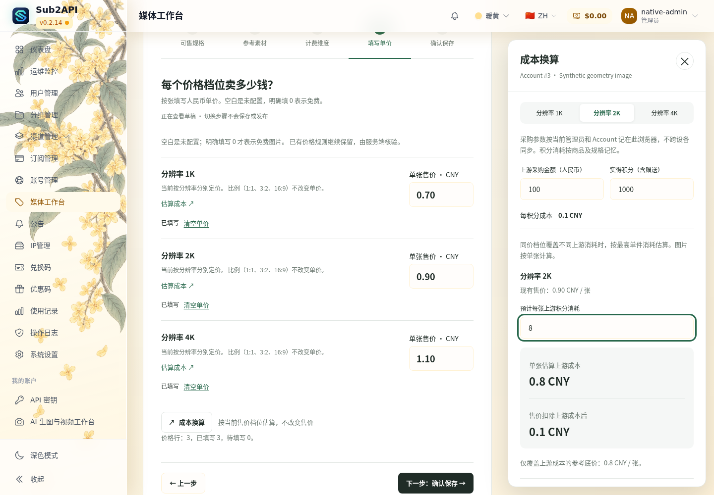
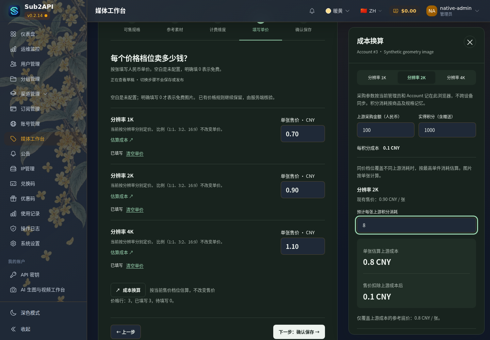
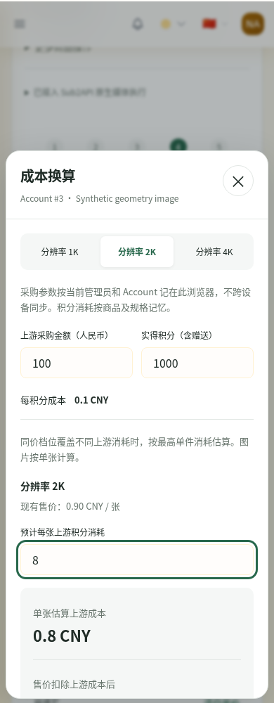
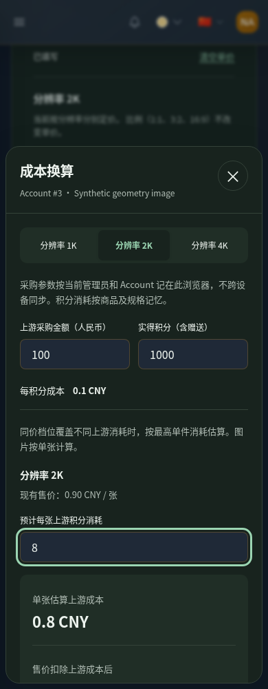

# 管理员媒体工作台：正式组件实现与真实隔离联调

**IMPLEMENTATION_READY_FOR_REVIEW_NOT_DEPLOYED**。PR #1 的三项条件审核均已有针对性实证；等待 ChatGPT 复审，没有部署或合并。

## 身份与修改范围

- 分支：`codex/admin-media-design-review`。
- 正式组件实现提交：`64cc40c4f06dbedd51f748fb9a52a83e99256479`。
- 本轮完整隔离联调的 Core 源码、构建/验收脚本：`f246974afaedf5a3d143bde57cee4378ddf87372`。其后若仅归档本文及证据，不能把证据归档提交当成测试镜像来源。
- `64cc40c4` 之后仅修验收脚本的场景隔离，`frontend/src`、`backend`、`studio` 运行实现没有继续变化。
- 对应审核：[PR #1](https://github.com/maximeblen654-boop/AI-Gateway-public/pull/1)，ChatGPT Review `5513583921` 与三条 Codex 评论。

| 修改位置 | 实际改动及保留的合同 |
| --- | --- |
| `frontend/src/views/admin/MediaWorkbenchView.vue`、`styles/media-workbench.css` | 接入第二版信息层级、模型列表、五步布局、整洁价格行与浅深色；桌面成本抽屉避让内容，手机底部面板。沿用站点外壳与主题。 |
| `components/admin/media/MediaProductEditor.vue` | 保留现有规格、参考素材、价格维度、保价确认与客户报价预览；每行可打开既有成本计算器；视频零价显示具体错误，不再标成免费可报价。 |
| `MediaCostCalculator.vue` | 原计算器改为当前售价档位抽屉，仍用 `costCalculator.ts` / `decimalText.ts` / 稳定规格键；没有第二份售价输入、计算算法或服务端成本合同。 |
| `MediaValidationPanel.vue` | 明确 64 条请求预览是抽样，不构造完整选择器/价格矩阵/eligibility。 |
| `MediaDialog.vue`、`mediaDialogFocus.ts` | 从既有对话框提取小型焦点循环供手机成本面板复用；Escape 关闭并返回触发按钮。 |
| 相关测试、既有 `native-media-candidate.yml` / `tools/native-media-e2e` | 增加有分支/环境约束的临时 Core 联调入口，不导出候选，不访问生产。 |

`useMediaWorkbench`、`pricingMatrix`、金额函数、Account mapping、后端发布/报价/执行/结算均沿用原实现。`prototype.js` 未导入应用；没有新建状态管理器、钱包、数据库或媒体适配器。正式 Handoff / Constraints 未修改。

## 三项条件审核的结果

| 审核项 | 实证 | 结果 |
| --- | --- | --- |
| 视频零价与免费图片 | 正式 Vue 对 0 元视频标记错误且不显示免费报价。通过真实 API 在隔离 Account 发布合成零价视频后，BFF 客户目录排除该商品、保留同 Account 正价商品。0 元图片真实报价、生成、下载成功，余额不变且原生 usage 增量为 1。 | PASS；没有扩展免费视频后端。 |
| 仅改草稿 | 客户先冻结 `2K / 3:2 / 3 张 / 0.90 CNY每张 / 三个单图单元`；管理员把新草稿改为 `9.99`、原生多图上限 2，但不发布。原任务仍按冻结的 2.70 CNY、三个单图请求执行，没有使用新草稿的 2+1 计划。 | PASS；Published revision 不变。 |
| 发布 / mapping / 路由变化 | 三种独立合成用户分别先取得有效报价，再改变对应依赖。实际提交均返回 **409 `image_binding_unavailable`**，`recovery: GET original task only`；上游生成增量 0、账务增量 0。 | PASS；保留原任务，不自动重发或改绑。 |
| 64 条抽样 | 实际预览 64 条均为 1K，完整商品保留 1K/2K/4K。4K、16:9 位于样本之外，仍经真实报价/执行/下载成功。独立组件用例生成 72 行价格，未被 64 截断；32768 服务端规格上限未修改。 | PASS。 |

机器核对：[contract-cross-check.json](implementation-evidence/run-38523316345/contract-cross-check.json)。它另外比较提交后的 offer、spec、单价、总价、数量、execution 与原报价一致，并逐项核对账务和原片摘要。离线复核命令：

```sh
node tools/native-media-e2e/check-admin-review.mjs docs/ui/admin-media-redesign-2026-10-14/implementation-evidence/run-38523316345
```

## 真正的前后端链路

页面来自临时 Core 镜像的嵌入资源，通过同源 loopback 代理访问 Core/Bridge/BFF。没有 Vite、4295 开发代理或浏览器 API mock；`artifact-assets.cjs` 将浏览器收到的组件 JS 与 Core 直连返回字节比较。仅模拟器替代收费供应商。

管理员五步选择规格/参考素材/价格 → 保存带 `expected_record_version` 的草稿 → Core API 和隔离 PostgreSQL 重读相同商品 → 服务端校验 → Account 发布二次确认 → 客户服务端冻结报价 → 确认后提交 → 模拟上游捕获参数 → 原片存储/下载 → 原生一次 usage/结算。

初建的两个图片商品通过正常五步填写，没有预填 `size_mappings` 或技术协议。同模型第二商品的 ID、规格和售价保持独立。真实 UI 验证了按分辨率 3 行、双维 6 行、统一价 1 行、再返回 3 行；相同旧价得到保留，保存不改变 Published 或第二商品，成本字段不进入请求。

| 场景 | 冻结规格 / 数量 | 实际模拟请求 | 总价 / 原生记录 |
| --- | --- | --- | --- |
| 文生图多张 | 1K、1:1、3 张 | `/v1/images/generations` 三次，每次 n=1，resolution=1K、aspect_ratio=1:1 | 2.10 CNY；usage +1 |
| 参考图编辑 | 2K、3:2、2 张，输入参考图 1 张 | `/v1/images/edits` 两次，每次 n=1、images=1，规格保持 2K/3:2 | 1.80 CNY；usage +1 |
| 超出预览样本的规格 | 4K、16:9、1 张 | generation 一次，resolution=4K、aspect_ratio=16:9；没有 size/auto 替换 | 1.10 CNY；usage +1 |
| 普通兼容单视频 | 720p、5 秒、16:9、1 条 | 原兼容路径一次提交，duration=5、resolution=720p、ratio=16:9 | 2.00 CNY；usage +1、capture +1，冻结余额归零 |
| 明确免费图片 | 1K、1:1、1 张 | generation 一次，仍走原生记录 | 0 CNY；余额不变，usage +1 |
| 草稿改价/执行上限后提交 | 2K、3:2、3 张 | 三次 n=1，保持原冻结计划 | 2.70 CNY；usage +1 |

上述六个成功场景都验证：下载文件摘要与模拟器原片一致；刷新、查询、再次下载不增加请求或账务。图片 SHA-256 为 `431ced6916a2a21a156e38701afe55bbd7f88969fbbfc56d7fe099d47f265460`；视频为 `9738ac5e6756d120b3a6805420362e31390b3b4a26b604dcacac86c660f72299`。

额外真实服务端检查：历史有效 `1024x1024 / 1:1` size mapping 保留在编译结果；`1536x1024 / 1:1` 冲突拒绝，恢复原合成草稿后继续。测试金额和上游原片都是合成数据；1 像素图片、蓝色短片用于验证请求、字节保存和资金合同，不用于宣称真实生成质量或供应商能力。

## 测试与审查

- 本地定向 Vitest：6 文件、100 项 PASS；TypeScript 和受影响文件 ESLint PASS。
- 正式 Vue＋Axios fixture 浏览器：17 项 PASS，含图片/视频草稿管理、五步导航、保价、禁用组合、缺价、免费、冲突、未保存保护及未支持能力。它们属于组件交互证据，不冒充后端联调。
- 成本抽屉 1440/390 × 浅/深色连续三轮：12 项 PASS；验证桌面不遮挡价格表、输入售价时保持展开并更新计算、手机键盘焦点、关闭返回、存储隔离/降级及不发生 API 写入。
- [最终 CI 38523320929](https://github.com/maximeblen654-boop/AI-Gateway-public/actions/runs/38523320929)：全部 PASS。包含前端类型检查/39 个关键 Vitest 文件/17 个浏览器用例、73 项 BFF 合同测试、Go 单元与 PostgreSQL 集成、golangci-lint 和现有脚本检查。
- [Security 38523320928](https://github.com/maximeblen654-boop/AI-Gateway-public/actions/runs/38523320928)：PASS；govulncheck、pnpm audit 及既有例外有效性检查。没有新增例外，不将工作流 PASS 扩写为所有依赖绝无已知风险。
- [真实 Core/Bridge/BFF 联调 38523316345](https://github.com/maximeblen654-boop/AI-Gateway-public/actions/runs/38523316345)：PASS，独立场景失败列表为空。此结果与截图均对应 `f246974a`。
- 前几次脚本失败及原因见 [prior-attempts.json](implementation-evidence/prior-attempts.json)。登录语言、恢复任务控件假设和共享测试用户已纠正；未知任务没有被删除、解锁或重发。后续完整 PASS 覆盖这些中断，未修改运行代码来放松保护。

partial、原生批次、已有视频特殊路径未发生运行代码变化，复用原合格证据并通过现有 CI 合同回归；本次新增真实栈仅覆盖上述受影响链路，不声称重新做了逐供应商实付验收。

## 正式 Core 页面截图

以下均为本轮真实 Core 页面，合成 Account #3；不是旧设计原型，不是生产 #77。

| 桌面 1440 浅色 | 桌面 1440 深色 |
| --- | --- |
|  |  |

| 手机 390 浅色 | 手机 390 深色 |
| --- | --- |
|  |  |

[完整价格页](implementation-evidence/run-38523316345/native-geometry-prices-desktop.png) · [手机价格维度](implementation-evidence/run-38523316345/native-geometry-dimensions-mobile.png) · [客户金额确认](implementation-evidence/run-38523316345/native-artifact-image-geometry-1k-confirmation.png) · [图片结果](implementation-evidence/run-38523316345/native-artifact-image-geometry-1k-result.png) · [视频结果](implementation-evidence/run-38523316345/native-artifact-video-compatible-result.png)。

实际查看上述截图后，未发现文字重叠、水平溢出或关闭按钮被遮挡。手机成本面板下部通过内部滚动查看；静态截图不替代键盘、滚动和焦点的浏览器断言。站点外壳暖黄主题与原 VERSION 徽标沿用，本轮没有修改全局品牌和版本号。

## 证据与停止位置

小体积 Artifact：`11874757651`，名称 `admin-ui-implementation-review-f246974afaedf5a3d143bde57cee4378ddf87372`，9,787,312 字节；云端到期 **2026-10-28 06:47:09 UTC（北京时间14:47:09）**。已取一份报告/截图到本目录 `implementation-evidence/run-38523316345/`，并随 PR 归档，见证据 SHA256SUMS。没有下载/导出新的完整镜像包。

三组件均 healthy，Bridge/BFF 共享本次 Core namespace；准确来源、挂载、文件摘要在 [acceptance.json](implementation-evidence/run-38523316345/acceptance.json)、[runtime-files.json](implementation-evidence/run-38523316345/runtime-files.json)、[reuse-proof.json](implementation-evidence/run-38523316345/reuse-proof.json)：

- 临时测试 Core：`sha256:7f65664bed8164297ef88c4ca1890b0fab79354022ca1767f6e7c5f610851a8e`，来源 `f246974afaedf5a3d143bde57cee4378ddf87372`。
- 复用 Bridge：`sha256:dd01aa29e152f589679e5065037459240aeb8ddfe3ec853c16033006fe67acda`。
- 复用 BFF：`sha256:e498b97225bfc15e286af26bff30ec5c8d84526adfdbcd8231ebf7bad50e3f21`。
- 两个复用组件来源均为 `b2fcdac93afa6ae194ee81801a9b37813f8f39eb`；源码/锁/配方/运行输入 Git 对象、原 TAR 和 Image ID 均核验。没有伪标为本次前端来源。

临时 Core 只用于被授权的真实后端联调，不是已保存的生产候选；runner 结束后其地址不可访问。本轮未连接生产、未部署、未修改生产商品/售价/开关，未调用真实供应商。合成商品仅在隔离环境发布和启用以运行测试。下一步仅等待 ChatGPT 复审，未自动准备部署候选或启动生产流程。
