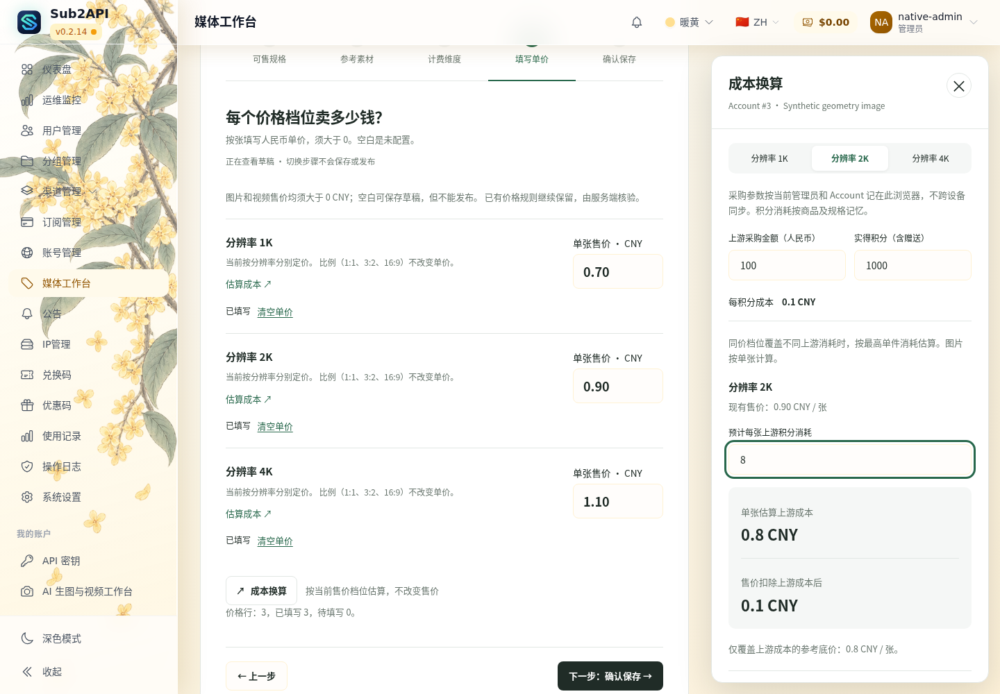

# 管理员媒体工作台 PR #1：运行候选审核入口

**CANDIDATE_READY_NOT_DEPLOYED**。正式 Vue 保留，图片/视频统一正价规则已落实，最终 Core＋原 b2 Bridge/BFF 组合已通过隔离验收。正式 Handoff / Constraints 未修改。

## 当前材料

1. **[最终候选报告、镜像身份、TAR、测试及截图](CANDIDATE_REPORT.md)**。
2. **[最终 PASS manifest](candidate-evidence/run-38541341605/manifest.json)**，SHA-256 `9741cb3cec6406354bd1ec829035c9a7746063f8ea802d3ed0707d7a51c26086`。
3. [真实成品验收](candidate-evidence/run-38541341605/acceptance.json)、[业务交叉核对](candidate-evidence/run-38541341605/contract-cross-check.json)、[零价边界](candidate-evidence/run-38541341605/native-positive-retail.json)、[CI / Security](candidate-evidence/run-38541341605/ci-status.json)。
4. [组件复用依据](candidate-evidence/run-38541341605/reuse-proof.json)、[运行源码与测试脚本等价边界](candidate-evidence/run-38541341605/runtime-equivalence.json)。

Core 运行源码：`15d09689abc0b7e07269692d50e78f83859d1fb6`；验收脚本：`5c8ee1d4af6fd4e4ea6686e43332049cc0aca218`；Bridge/BFF：`b2fcdac93afa6ae194ee81801a9b37813f8f39eb`。文档归档提交不代表镜像源码。

[最终补验 Run 38541341605 PASS](https://github.com/maximeblen654-boop/AI-Gateway-public/actions/runs/38541341605)。它加载原构建产物，没有重复构建或导出 TAR。完整 Artifact 11882680877；最终小证据 11882812063。完整本地候选位置见报告。

## 最终镜像的页面

[桌面深色](candidate-evidence/run-38541341605/native-admin-formal-1440-dark.png) · [390px 手机浅色](candidate-evidence/run-38541341605/native-admin-formal-390-light.png) · [390px 手机深色](candidate-evidence/run-38541341605/native-admin-formal-390-dark.png) · [手机规格流程](candidate-evidence/run-38541341605/native-geometry-dimensions-mobile.png) · [报价确认](candidate-evidence/run-38541341605/native-artifact-image-geometry-4k-confirmation.png) · [单视频结果](candidate-evidence/run-38541341605/native-artifact-video-compatible-result.png)。

真实 Core 嵌入页面，无 Vite/prototype/API mock；数据和成品均为隔离合成样本。runner 已结束，不提供失效预览地址。本轮未连接生产，不部署、不启售、不实付。

## 历史资料

[实现阶段报告](IMPLEMENTATION_REPORT.md)、[前后端合同审查](INTEGRATION_REVIEW.md)、[旧实现复审提示](CHATGPT_REVIEW_PROMPT.md)保留溯源。实现阶段的免费图片样例已被本轮用户明确的“图片和视频售价均大于0”替代，不能作为当前业务规则。

[第二版设计说明](REVIEW_V2.md)、`shots/`、`motion/record-cost.mp4`、`prototype.js` 与旧 `ASSET_MANIFEST.json` 是设计资料，不是本次运行候选或联调证明。
