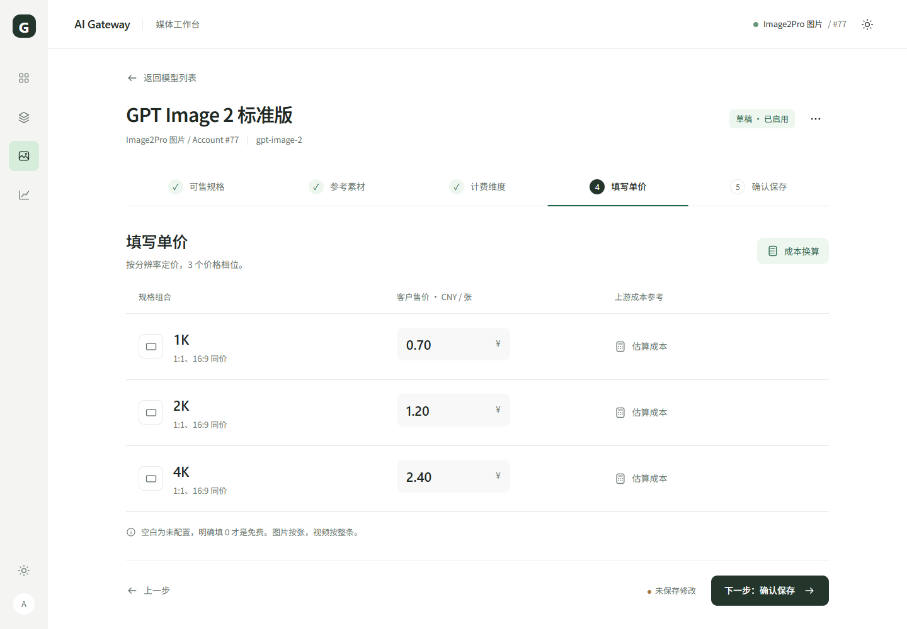
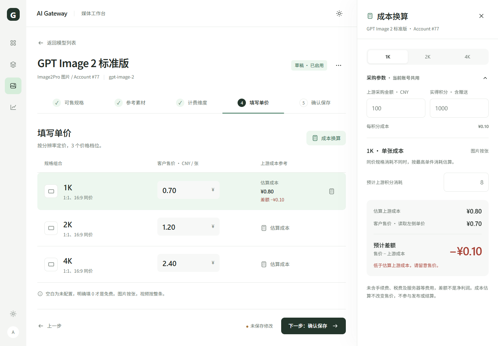
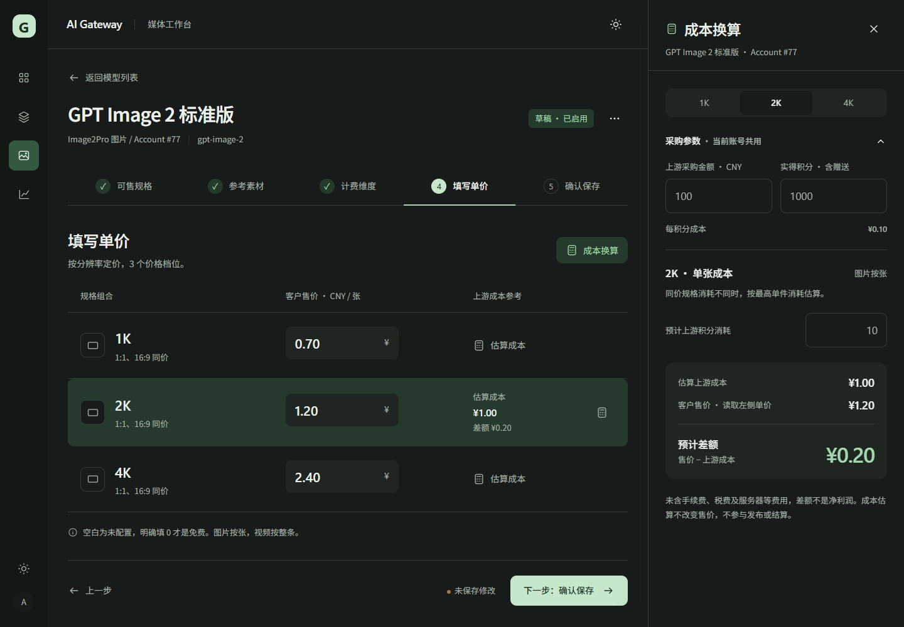
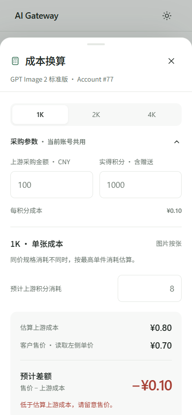

# 管理员媒体工作台：设计与联调审核入口

状态：**DESIGN_REVIEW_ONLY · BACKEND_INTEGRATION_NOT_DONE**。

这是 oil-ui 第二版可操作设计稿，范围仅为管理员媒体工作台。用户尚未确认最终设计；本次提交用于 ChatGPT / Codex 审核，不是正式 UI 实现、运行候选或部署。

运行代码基线：`a14000c68c1f090d34c8fde0197d860d2d767215`（包含已完成、尚未部署的成本计算器）。本分支只新增本目录，未修改 frontend、backend、Studio、构建或部署配方。正式 Handoff / Constraints 保持不变。

## 先看什么

1. [前后端联调审查清单](INTEGRATION_REVIEW.md)：尤其图片比例、分辨率、价格组合、保存与实际请求是否使用同一合同。
2. [第二版设计说明](REVIEW_V2.md)：视觉意图、交互、既有演示验证和局限。
3. [交给 ChatGPT / Codex 的审核提示词](CHATGPT_REVIEW_PROMPT.md)。

**现有后端已有规格处理链，新外观尚未接回该链。不能把这个原型未接通，误报成现有生产后端不支持；也不能用原型通过，证明新外观已经联调。**

## 视觉预览

### 默认价格页面（1440px）


### 按售价档位打开成本换算（1440px）


### 深色


### 手机（390px）


[4 秒交互录屏](motion/record-cost.mp4)。截图及视频均来自本地设计原型，账号、模型、金额与状态均为合成示例，不能当成生产 Account #77 的现场信息。

## 本地打开原型

在仓库根目录执行：

```sh
python -m http.server 4396 --bind 127.0.0.1 --directory docs/ui/admin-media-redesign-2026-10-14
```

然后访问 `http://127.0.0.1:4396/index.html`。如端口占用可改为其他本地端口。GitHub 文件页仅展示源码，不会运行 HTML；此提交不发布公网预览。

操作：价格行“估算成本” → 切换档位 → 改积分 → 关闭 → 切换步骤 → 返回模型列表。主题按钮可切换浅深色。刷新会重置演示数据。保存、发布、销售仅显示标明“预览”的对话框，不发业务请求。

字体优先使用本机 Noto Sans SC；未安装时会回退。没有携带第三方字体二进制，正式实施前需确定可分发字体与回退效果。

## 验证口径

- [interaction-results.json](interaction-results.json)：原本地原型连续 3 次浏览器交互 PASS；不是 Core/Bridge/BFF 联调结果。
- `costCalculator.js` / `decimalText.js` 由基线已有 TypeScript 纯函数转译供演示，未另造成本算法；正式实现仍导入原模块。
- [check-prototype.cjs](check-prototype.cjs) 为原检查脚本的路径可移植副本，参数为本机原型地址和报告输出位置；结果需区分原始证据与此次可移植副本运行。
- [archive-check-results.json](archive-check-results.json)：归档后通过临时 127.0.0.1:4397 静态服务运行可移植脚本，3 次 PASS；仍仅为原型检查，服务已停止。
- [ASSET_MANIFEST.json](ASSET_MANIFEST.json) 记录原型和原始截图/报告的摘要，用于核对归档来源。
- 本轮不重跑全量业务测试、不构建候选、不连接生产。下一阶段必须用真实隔离后端补 INTEGRATION_REVIEW 中的验收。

设计目标：让售价表成为主操作区，成本估算随当前档位按需展开。将信息层级、抽屉手感与真实业务合同分别审查，设计确认后再进入应用组件实现。
