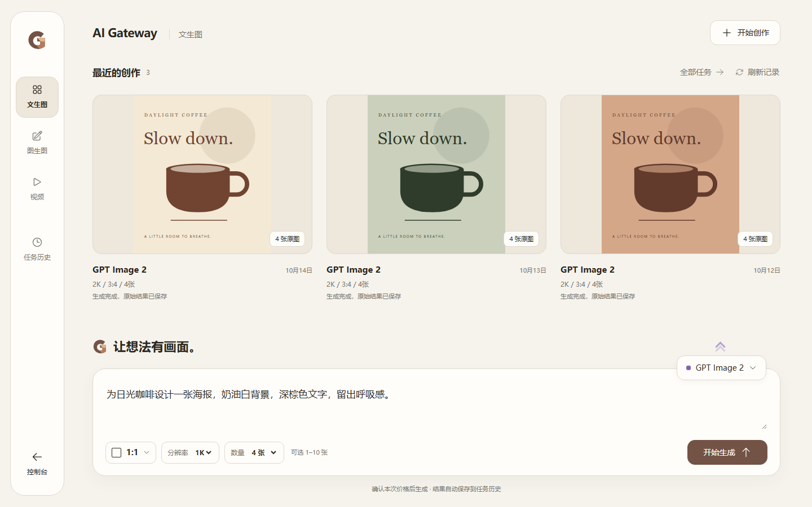

# AI Gateway 客户工作台 · C 作品桌

本阶段目标是重新设计客户生成工作台，不是管理员五步向导或旧表单的局部润色。

[打开离线对比页](style-explorer.html)（下载后在浏览器打开；GitHub 本身只显示 HTML 源码）。

| 方案 | 工作方式 | 截图 |
| --- | --- | --- |
| A · 轻聊（推荐） | 居中创作输入，悬浮模型/比例，左侧任务历史 | [A](screenshots/a.png) |
| B · 对照 | 左侧描述、右侧查看已有作品 | [B](screenshots/b.png) |
| C · 作品桌 | 历史作品作为主工作区，底部创作条 | [C](screenshots/c.png) |

主文案：**让想法有画面。**

三版使用同一份 `content.json` 合成内容；海报为 HTML/CSS 排版的设计素材，不是供应商生成结果。截图是 1440×900 的 Chromium 实际渲染，已经逐张查看。原始参考截图未上传，未包含生产账号/价格/凭据。

以上三版为阶段一选版存档。用户已选择 C，当前完整 Vue 工作台及真实隔离前后端联调已经完成，详见下方与 Handoff。

- 本地服务：`python -m http.server 4294 --bind 127.0.0.1 --directory docs/ui/studio-redesign-2026-10-14`。
- 原始 HTML：`a.html`、`b.html`、`c.html`；比较页可离线打开。
- 重建方向 HTML：`python docs/ui/studio-redesign-2026-10-14/build_previews.py`。
- 对比页由 oil-ui 0.22.2 的 `scripts/build_explorer.py manifest.json --force` 生成。
- [本阶段工程交接](HANDOFF.md)。

## 当前完整实现

主操作为“开始生成”，取得服务端冻结报价后确认本次金额；文生图无附件、图生图有圆形回形针、视频沿当前模型素材能力，保留粘贴拖拽。历史和交付仍使用原有后端；没有历史时显示“让想法有画面。”。

[手机](screenshots/c-gallery-mobile.png) · [无历史](screenshots/c-empty-desktop.png) · [图生图附件](screenshots/c-edit-mobile.png) · [深色](screenshots/c-dark-mobile.png) · [真实前后端结果](evidence/real-backend-summary.json)

本地预览（隔离 UI fixture）：`http://127.0.0.1:4295/tests/studio-workspace/index.html`。从 frontend 运行 `node node_modules/vite/bin/vite.js --config tests/studio-workspace/vite.config.ts` 可启动。云端实际联调使用相同 Vue 组件及真实 Core/Bridge/BFF，只有上游为模拟器；证据与版本见 [HANDOFF](HANDOFF.md)。未部署生产。
